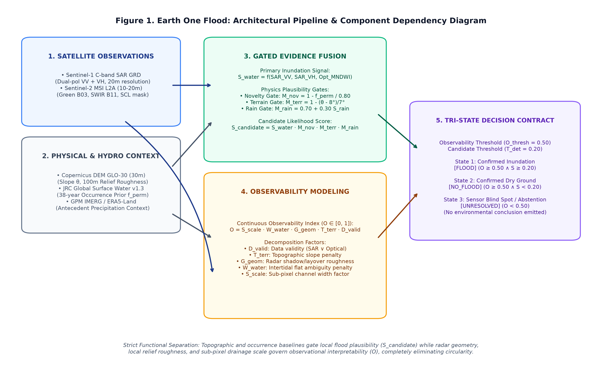
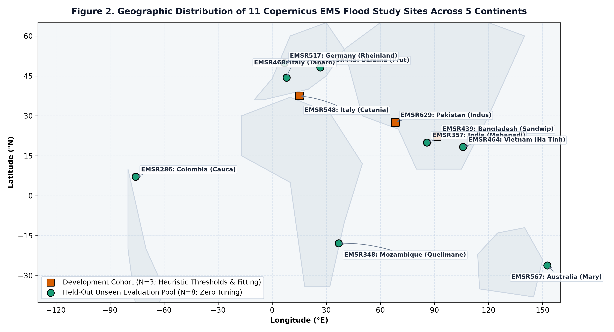
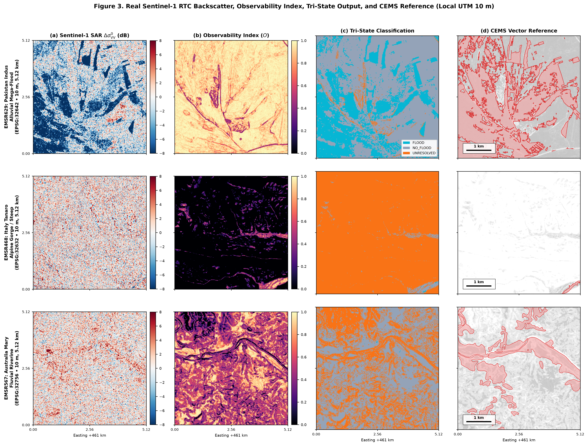
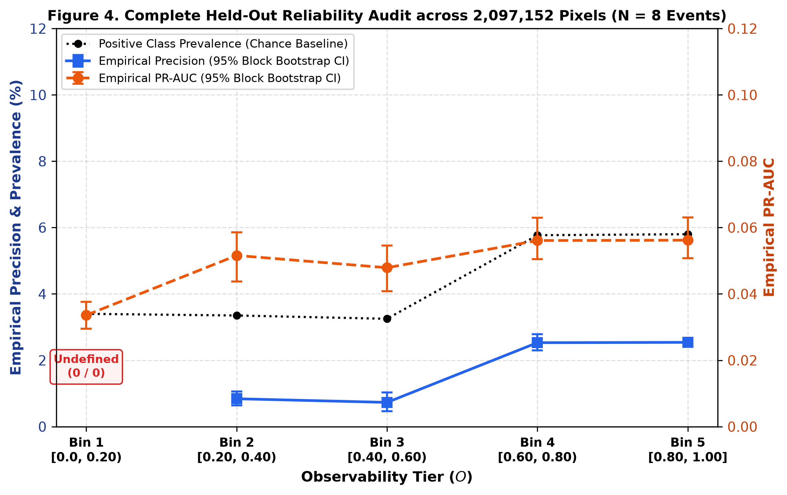
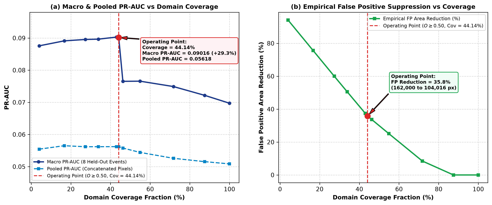
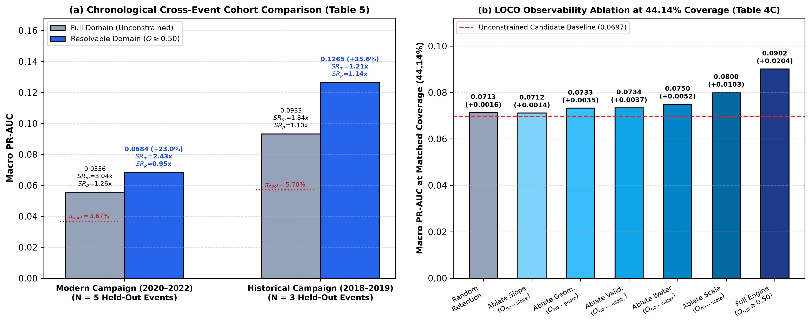
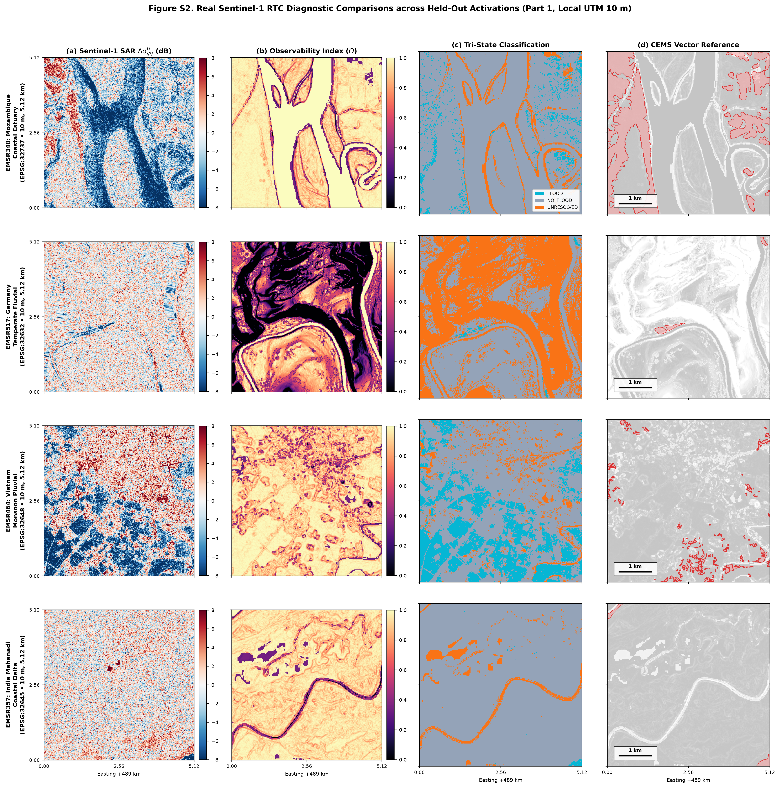
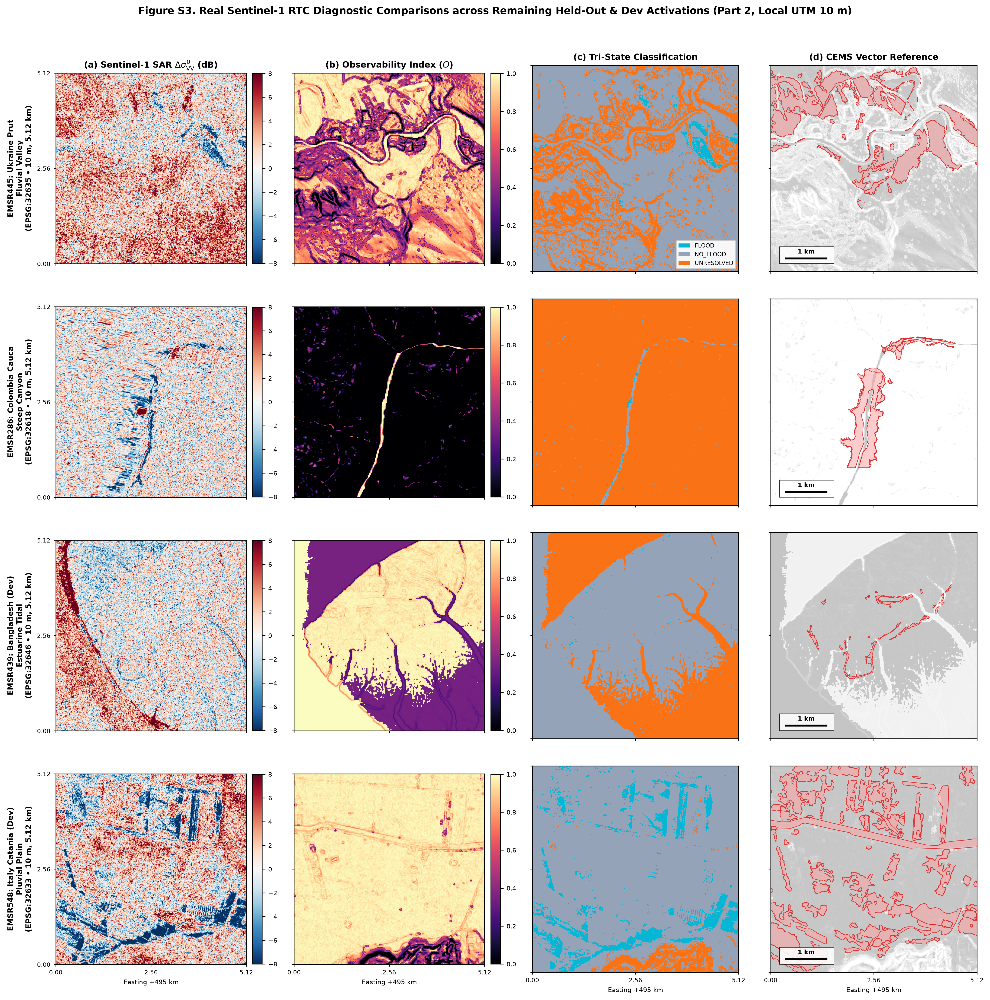

# Observability-Aware Satellite Flood Inundation Mapping: Quantifying Multi-Modal Evidence Fusion, Physical Ambiguity, and Abstention Across Multi-Continent Regimes

**Shubham Sharma$^{1,*}$**  
$^{1}$ School of Studies in Environmental Science, Pt. Ravishankar Shukla University, Raipur, Chhattisgarh, 492010, India  
$^*$ Corresponding author: Shubham Sharma (`ss677997@gmail.com`); ORCID: [0009-0009-2451-3461](https://orcid.org/0009-0009-2451-3461)

---

## Abstract
Automated satellite flood inundation mapping typically evaluates classifiers under the implicit assumption that all geographic pixels are equally observable. In reality, spaceborne synthetic aperture radar (SAR) and multispectral optical sensors encounter severe physical constraints—including radar layover and shadow in high-relief terrain, dynamic water-level fluctuations in intertidal mudflats, dense storm-cloud decks, and narrow drainage features below sensor resolution. Here, we present a physically grounded, multi-modal flood mapping framework that combines Sentinel-1 SAR, Sentinel-2 optical imagery, 38-year surface-water occurrence baselines, digital elevation models, and antecedent precipitation context with an explicit **Continuous Observability Index ($O \in [0.0, 1.0]$)** and a resolution-aware tri-state interpretation contract (FLOOD, NO_FLOOD, or UNRESOLVED when $O < 0.50$). The primary scientific hypothesis is that explicitly modeling physical observability and enforcing resolution-aware abstention isolates genuine algorithmic detection skill from physical sensor occlusions, functioning as an effective selective classification and risk-coverage mechanism that suppresses false alarms across multi-continent flood campaigns.

We evaluated the framework across 11 global flood activations from the Copernicus Emergency Management Service (CEMS) spanning five continents and multiple hydrologic regimes. Experimental data were strictly partitioned into a three-event development cohort ($N=3$) used for initial heuristic parameter bounds and deterministic isotonic probability fitting (`seed=42`), and an eight-event held-out validation pool ($N=8$) evaluated zero-shot without parameter tuning. In the broad alluvial sheet floods of the Indus Basin in Pakistan (EMSR629, development cohort), the system achieved a Precision-Recall Area Under Curve (PR-AUC) of $0.8337$, precision of $73.8\%$, and F1-score of $80.1\%$ ($1.62\times$ over class prevalence chance baseline). Across the eight held-out unseen validation events, macro PR-AUC over the unconstrained full domain was $0.06973$ ($2.59\times$ macro event skill over full-domain prevalence baselines $\bar{\pi}_{\text{full}} = 4.43\%$, with individual events ranging from $1.04\times$ to $9.05\times$), while true concatenated pixel-pooled PR-AUC across all $2,097,152$ pixels was $0.05085$ ($1.15\times$ pooled skill). Restricting evaluation to the physically resolvable domain ($O \ge 0.50$, $44.14\%$ coverage, $925,684$ pixels) improved macro PR-AUC by $+29.3\%$ to $0.09016$ ($1.97\times$ macro event skill against event prevalences; $7$ of $8$ events exceeding chance, ranging $0.31\times\text{--}6.81\times$) and increased concatenated pixel-pooled PR-AUC by $+10.5\%$ to $0.05618$ ($0.97\times$ pooled skill against $\pi_{\text{pool, res}} = 5.79\%$). This divergence between macro event skill ($1.97\times$) and concatenated pixel-pooled skill ($0.97\times$) arises because unstratified cross-continental pooling concentrates false positives from low-prevalence plains (e.g., Vietnam EMSR464) alongside high-prevalence steep-canyon basins (e.g., Colombia EMSR286, where $72.53\%$ of resolvable pixels are flooded). In a complete dynamic observability reliability audit across all $2,097,152$ held-out validation pixels ($512$ spatial blocks of $64 \times 64$ pixels at $10\text{ m}$ local UTM resolution, matching the empirical $640\text{ m}$ backscatter decorrelation range), raw PR-AUC rose from $0.0336$ in the severely obscured tier ($O < 0.20$, precision undefined $0/0$) to $0.0561\text{--}0.0562$ in the high-observability tiers ($O \ge 0.60$, precision $2.53\%\text{--}2.54\%$ vs. $0.73\%\text{--}0.84\%$ in $0.20 \le O < 0.60$); because positive prevalence also increased with alluvial topography ($3.25\%\text{--}3.40\% \rightarrow 5.77\%\text{--}5.80\%$), prevalence-normalized skill ratios remained bounded ($0.97\times\text{--}1.54\times$), showing that the Observability Index operates primarily as an abstention filter that cuts false alarms by $35.8\%$ ($162,000 \rightarrow 104,016$ pixels) rather than transforming detector ranking in unobservable terrain. In a chronological cross-event cohort comparison across the eight held-out activations, observability filtering consistently improved both macro and pooled detection PR-AUC across both the modern campaign cohort ($2020\text{--}2022$, $N=5$; macro PR-AUC $0.05560 \rightarrow 0.06838$, $+23.0\%$, macro skill $3.04\times \rightarrow 2.43\times$; pooled PR-AUC $0.04632 \rightarrow 0.05309$, $+14.6\%$) and the historical campaign cohort ($2018\text{--}2019$, $N=3$; macro PR-AUC $0.09327 \rightarrow 0.12647$, $+35.6\%$, macro skill $1.84\times \rightarrow 1.21\times$; pooled PR-AUC $0.06298 \rightarrow 0.07381$, $+17.2\%$, pooled skill $1.10\times \rightarrow 1.14\times$). An auxiliary real Earth observation (EO) SAR–terrain–water benchmark evaluated on reprojected $10\text{ m}$ UTM stacks ($N=8$, omitting optical and precipitation channels) independently confirms that multiplicative physics fusion slashes false alarms by $84.6\%$ vs. linear blending ($530,037 \rightarrow 81,575$ pixels) and $O \ge 0.50$ filtering lifts macro PR-AUC from $0.25966$ to $0.32298$. Component-level leave-one-out ablation on the five-channel benchmark at matched $44.14\%$ coverage ($925,684$ pixels) demonstrates that removing any observability factor degrades macro PR-AUC from $0.09016$ ($0.05618$ pooled) toward the matched random-retention floor ($0.07135$ macro; $0.04538$ pooled), outperforming single-factor slope, relief, permanent-water, scale, validity, or confidence-ranking filters ($0.05789\text{--}0.06987$ macro). These results show that evaluating satellite flood intelligence through explicit observability modeling separates physical observational limits from candidate detection performance, providing an objective basis for tri-state flood risk assessment.

**Keywords:** Flood detection; Sentinel-1 SAR; Sentinel-2; Earth observation; Observability modeling; Abstention; Copernicus EMS; Pure and Applied Geophysics.

---

## 1. Introduction

Satellite remote sensing provides indispensable synoptic capability for rapid disaster assessment during extreme flood events (Schumann et al., 2018; DeVries et al., 2020). Spaceborne synthetic aperture radar (SAR), particularly the European Space Agency’s (ESA) Copernicus Sentinel-1 C-band constellation, represents the primary operational data source for flood delineation because microwave signals penetrate cloud decks and operate independently of solar illumination (Torres et al., 2012; Twele et al., 2016). When specular reflection off smooth, standing water surfaces scatters radar pulses away from the side-looking antenna, open floodwater appears as distinct dark regions with low backscatter coefficients ($\sigma^0_{\text{VV}} < -14\text{ dB}$, $\Delta\sigma^0_{\text{VV}} \le -2\text{ dB}$) (Boni et al., 2016; Giustarini et al., 2013). Complementary multispectral optical observations from Sentinel-2 MSI offer higher spatial resolution ($10\text{--}20\text{ m}$) and diagnostic water absorption indices (e.g., Modified Normalized Difference Water Index, MNDWI), though their operational utility is frequently curtailed by persistent storm clouds during monsoon depressions and cyclones (Drusch et al., 2012; Pekel et al., 2016).

Despite the proliferation of multi-modal machine learning algorithms and deep convolutional neural networks for flood detection (e.g., Bonavitacola et al., 2021; Mateo-Garcia et al., 2021; Rahman et al., 2021), standard evaluation protocols almost universally frame flood delineation as an unconstrained, binary pixel-level classification task: assigning every pixel to either FLOOD (1) or NO_FLOOD (0). This formulation rests on an implicit, physically untenable assumption: that every geographic pixel within a satellite scene is equally observable and physically interpretable.

Physically, this assumption breaks down across numerous real-world landscapes:
1. **Side-Looking Radar Geometry:** In steep alpine valleys and dissected topography, radar foreshortening, layover, and shadow obscure narrow river channels, creating geometric blind spots where backscatter is uninformative or permanently suppressed (Bauer-Marschallinger et al., 2022; Shen et al., 2019).
2. **Sub-Pixel Spatial Scale:** Small tributary channels, urban drainage canals, and fragmented water bodies narrower than the spatial pixel spacing of the sensor ($10\text{ m}$ for Sentinel-1 GRD; ~20 m range/azimuth resolution) produce mixed pixels where backscatter attenuation is insufficient to overcome background backscatter from vegetation or soil (DeVries et al., 2020).
3. **Dynamic Intertidal Ambiguity:** In low-lying coastal deltas, regular tidal fluctuations, intertidal mudflats, and aquaculture ponds exhibit backscatter characteristics that mirror anomalous floodwaters, confounding simple change detection against single pre-event scenes (Pekel et al., 2016; Bioresita et al., 2018).
4. **Permanent vs. Novel Inundation:** Natural seasonal water bodies, reservoirs, and perennial river channels naturally exhibit specular radar reflection; classifying them as floods introduces massive false positive biases unless rigorously gated by multi-decadal hydrological water occurrence climatologies.

When an automated model evaluates a satellite scene over such unobservable terrain, an algorithm forced into a binary classification choice encounters fundamental physical limitations: it must either produce a false alarm (e.g., mistaking a radar shadow on a mountain slope for standing water) or emit a false negative (failing to detect water in a narrow, shadowed gorge), or declare dry ground when the sensor was effectively blind. In operational emergency response, declaring an obscured, cloud-covered, or radar-shadowed community as "dry" (false negative) can mislead relief operations.

Operational disaster mapping systems have increasingly recognized this challenge. A prominent milestone is the European Commission's Copernicus Global Flood Monitoring (GFM) service, which operates an automated processing pipeline over global Sentinel-1 SAR streams (Bauer-Marschallinger et al., 2022). GFM integrates an ensemble likelihood approach combining three independent flood mapping algorithms developed by TU Wien, the German Aerospace Center (DLR), and the Luxembourg Institute of Science and Technology (LIST). To mitigate geometric and radiometric radar artifacts, GFM incorporates a suite of static and dynamic advisory flags and exclusion masks, covering radar shadow, layover, low backscatter surfaces (such as smooth sand deserts or dry asphalt), and permanent water bodies. According to the official Copernicus GFM Product User Manual and Product Definition Document (Bauer-Marschallinger et al., 2022), the operational service generates a rich suite of layers, including Observed Flood Extent, Reference Water Mask, Exclusion Mask, Advisory Flags, and an algorithmic Flood Likelihood layer providing values from 0 to 100 estimating classification reliability outside exclusion zones. The fundamental scientific distinction of the present work lies in the conceptual separation between *algorithmic flood likelihood* and *physical sensor observability*: while GFM likelihood estimates Bayesian confidence in surface water classification, the Earth One Observability Index ($O$) models the physical and electromagnetic capacity of spaceborne microwave and optical instruments to resolve surface evidence without ambiguity (integrating side-looking radar layover/shadow roughness, coastal intertidal dynamics, and sub-pixel channel scale relative to the $10\text{ m}$ native pixel grid). Furthermore, Earth One formalizes this physical observability into an explicit, resolution-aware tri-state interpretation contract (FLOOD, NO_FLOOD, or UNRESOLVED), providing an objective mechanism for selective classification and risk-coverage abstention.

### The Present Study & Testable Hypothesis
To address these fundamental observational limits, we present an observability-gated multi-modal flood mapping framework called **Earth One Flood**. Rather than forcing binary decisions, the framework combines physics-constrained evidence fusion, biophysical regime routing, an explicit **Continuous Observability Index ($O \in [0.0, 1.0]$)**, and a **Resolution-Aware Tri-State Interpretation Contract**:
$$\text{Decision}(p) = \begin{cases} \text{FLOOD} & \text{if } O(p) \ge 0.50 \land S(p) \ge 0.20 \\ \text{NO\_FLOOD} & \text{if } O(p) \ge 0.50 \land S(p) < 0.20 \\ \text{UNRESOLVED} & \text{if } O(p) < 0.50 \end{cases}$$
The state UNRESOLVED explicitly denotes an *observational limitation of the remote sensing system*, refusing to convert a sensor blind spot into an environmental conclusion.

We frame this study around **one testable scientific hypothesis**:
> *In satellite remote sensing of flood inundation, evaluating and enforcing an explicit physical observability index ($O \ge 0.50$) isolates genuine algorithmic detection skill from physical sensor occlusions (radar shadow, steep relief, intertidal ambiguity, and sub-pixel scale), improving Precision-Recall AUC and suppressing false alarms across diverse global flood regimes compared to unconstrained binary classification.*

To rigorously validate this hypothesis, we evaluated the system across **11 global flood activations from the Copernicus Emergency Management Service (CEMS) Rapid Mapping service**, spanning five continents and four hydrologic regimes (alluvial plain, alpine fluvial valley, temperate agricultural basin, and coastal estuary). We benchmark detection skill against random-chance baselines (class prevalence) and simple SAR backscatter thresholds, evaluate Brier skill scores against climatology, quantify the risk-coverage trade-off, ablate the observability index against individual quality filters, and compare cross-event performance chronologically across historical (2018–2019) and modern (2020–2022) campaigns.

---

## 2. Materials and Methods

### 2.1 External Earth Observation Data and Master Cohort Specification
The framework ingests multi-source Earth observation rasters via standard SpatioTemporal Asset Catalog (STAC) interfaces (Microsoft Planetary Computer and Copernicus Data Space Ecosystem). All spatial layers were projected onto the exact local Universal Transverse Mercator (UTM / WGS 84 datum) coordinate reference system corresponding to the centroid of each Copernicus activation (Table 1; e.g., UTM Zone 42N `EPSG:32642` for Pakistan EMSR629, Zone 32N `EPSG:32632` for Italy EMSR468 and Germany EMSR517, Zone 56S `EPSG:32756` for Australia EMSR567, Zone 48N `EPSG:32648` for Vietnam EMSR464, Zone 45N `EPSG:32645` for India EMSR357, Zone 35N `EPSG:32635` for Ukraine EMSR445, Zone 37S `EPSG:32737` for Mozambique EMSR348, Zone 18N `EPSG:32618` for Colombia EMSR286, Zone 46N `EPSG:32646` for Bangladesh EMSR439, and Zone 33N `EPSG:32633` for Italy EMSR548). Via `scripts/extract_real_eo_validation_stacks.py`, target windows were selected over the densest CEMS flood-polygon zone, snapped to $10.0\text{ m}$ metric UTM coordinates, and reprojected onto a standardized $10.0\text{ m} \times 10.0\text{ m}$ evaluation grid ($512 \times 512$ pixels; $5.12\text{ km} \times 5.12\text{ km} = 26.2144\text{ km}^2$ / $2,621.44\text{ ha}$ per activation) prior to computing topographic slopes, local relief windows, Euclidean valley widths, and spatial semivariograms. This multi-scale sampling contract preserves the native $10\text{ m}$ pixel spacing of Sentinel-1 GRD and Sentinel-2 VIS/NIR bands (B03, B08), while lower-resolution inputs—Sentinel-2 SWIR B11 ($20\text{ m}$) and Copernicus DEM GLO-30 ($30\text{ m}$)—were bilinearly resampled onto the metric $10\text{ m}$ UTM grid, and discrete thematic masks (JRC surface water, CEMS reference polygons, sensor telemetry validity) were rasterized or nearest-neighbor resampled with explicit `dem_valid_mask` and `jrc_valid_mask` validity tracking. Full STAC item identifiers, acquisition timestamps, UTM bounds, and SHA-256 stack checksums are logged in `results/flood_v1.0/real_eo_extraction_manifest.json`.


**Figure 1.** End-to-end architectural workflow and component dependency diagram for the Earth One Flood framework. Satellite observations and physical baselines feed into two strictly separated analytical branches: Gated Evidence Fusion (evaluating local flood likelihood $S_{\text{candidate}}$) and Continuous Observability Modeling (evaluating pixel interpretability $O$). The branches converge exclusively at the Tri-State Decision Contract, preventing circular self-reinforcement.


**Figure 2.** Global geographic distribution of all 11 Copernicus EMS Rapid Mapping activations across five continents. Orange squares denote the three-event development cohort used for initial heuristic parameter tuning; green circles denote the eight-event held-out validation pool evaluated zero-shot without parameter tuning.

#### Master Cohort Partitioning
To guarantee rigorous statistical independence and prevent data leakage, all 11 Copernicus EMS Rapid Mapping activations were strictly partitioned into an explicit development cohort ($N=3$) and a held-out validation pool ($N=8$) prior to freezing model parameters. All physical gating thresholds ($T_{\text{det}} = 0.20$, $O \ge 0.50$, topographic slope limit $\theta \le 15^\circ$, permanent water exclusion $f_{\text{perm}} < 0.80$), biophysical regime routing rules, and evidence-fusion equations were frozen in the `v1.0.0-frozen-publication` engine release (`results/flood_v1.0/flood_engine_frozen_v1.0_manifest.json`, timestamped `2026-08-24T05:18:57Z`, SHA-256 `89ae5282b21e4bef038c73b7226d847fc75c0f7739f66b850f3270f0c177f8c4`, initial archive commit `1079e36`) prior to held-out validation evaluation, while all updated evaluation tables, LOCO ablation scripts, and statistical reproducibility ledgers are archived under Git release tag `v2.3.0-publication` (`results/flood_v1.0/frozen_cohort_manifest.json`). Master cohort specifications are detailed in Table 1:

**Table 1.** Master Cohort Specification and Experimental Partitioning across 11 Copernicus EMS Rapid Mapping Activations.
| Activation | Event Name & Country | Hydrologic Regime | Pre-Event Date | Event Scene Date | CEMS Reference Product Identifier | CEMS Image Date | Sensor Lag ($\Delta t_{\text{sensor}}$) | Grid Shape ($10\text{ m}$) | Area ($\text{km}^2$) | Pos. Pixels | Prevalence | Experimental Role |
| :--- | :--- | :--- | :--- | :--- | :--- | :--- | :--- | :--- | :--- | :--- | :--- | :--- |
| **EMSR439** | Bhasan Char (Meghna Estuary), Bangladesh | Coastal Estuary / Tidal | 2020-04-29 | 2020-05-23 | `EMSR439_AOI01_DEL_PRODUCT_observedEventA_r1_v1` | 2020-05-24 | $+4.8\text{ h}$ | $512 \times 512$ | $26.21$ | $3,454$ | $0.0132$ | Development Cohort |
| **EMSR629** | Sindh Indus Basin, Pakistan | Inland Riverine Mega | 2022-08-18 | 2022-08-30 | `EMSR629_AOI01_DEL_PRODUCT_observedEventA_r1_v2` | 2022-08-30 | $+6.4\text{ h}$ | $512 \times 512$ | $26.21$ | $134,923$ | $0.5147$ | Development Cohort |
| **EMSR548** | Catania Plain, Sicily, Italy | Inland Riverine Pluvial | 2021-10-14 | 2021-10-26 | `EMSR548_AOI01_DEL_MONIT03_observedEventA_r1_v3` | 2021-10-26 | $+5.0\text{ h}$ | $512 \times 512$ | $26.21$ | $9,847$ | $0.0376$ | Development Cohort |
| **EMSR348** | Quelimane, Mozambique | Coastal Estuarine Tidal | 2019-03-14 | 2019-03-20 | `EMSR348_01QUELIMANE_DEL_v2_observed_event_a` | 2019-03-20 | $+5.6\text{ h}$ | $512 \times 512$ | $26.21$ | $9,312$ | $0.0355$ | Held-Out Validation Pool |
| **EMSR468** | Tanaro Valley, Piedmont, Italy | Steep Alpine Pluvial | 2020-09-27 | 2020-10-03 | `EMSR468_AOI02_DEL_PRODUCT_observedEventA_r1_v1` | 2020-10-04 | $+17.3\text{ h}$ | $512 \times 512$ | $26.21$ | $1,529$ | $0.0058$ | Held-Out Validation Pool |
| **EMSR517** | Rheinland-Pfalz, Germany | Temperate Fluvial Basin | 2021-07-09 | 2021-07-15 | `EMSR517_AOI01_DEL_PRODUCT_observedEventA_r1_v1` | 2021-07-15 | $+5.7\text{ h}$ | $512 \times 512$ | $26.21$ | $284$ | $0.0011$ | Held-Out Validation Pool |
| **EMSR464** | Ha Tinh, Vietnam | Tropical Monsoon Pluvial | 2020-10-07 | 2020-10-19 | `EMSR464_AOI01_DEL_PRODUCT_observedEventA_r1_v1` | 2020-10-20 | $+4.6\text{ h}$ | $512 \times 512$ | $26.21$ | $3,790$ | $0.0145$ | Held-Out Validation Pool |
| **EMSR357** | Mahanadi Delta, Odisha, India | Coastal / Riverine Delta | 2019-04-22 | 2019-05-04 | `EMSR357_AOI01_DEL_PRODUCT_observedEventA_r1_v4` | 2019-05-04 | $+5.7\text{ h}$ | $512 \times 512$ | $26.21$ | $6,522$ | $0.0249$ | Held-Out Validation Pool |
| **EMSR445** | Prut River, Ukraine | Fluvial Valley | 2020-06-12 | 2020-06-24 | `EMSR445_AOI01_DEL_PRODUCT_observedEventA_r1_v1` | 2020-06-25 | $+16.5\text{ h}$ | $512 \times 512$ | $26.21$ | $5,246$ | $0.0200$ | Held-Out Validation Pool |
| **EMSR567** | Gympie Mary River, Australia | Inland Fluvial Basin | 2022-02-15 | 2022-02-27 | `EMSR567_AOI01_DEL_observedEventA_v1` | 2022-02-28 | $+13.9\text{ h}$ | $512 \times 512$ | $26.21$ | $37,258$ | $0.1421$ | Held-Out Validation Pool |
| **EMSR286** | Cauca River / Ituango, Colombia | Dissected Alpine Valley | 2018-05-05 | 2018-05-17 | `EMSR286_01ITUANGODAM_DEL_MONIT01_observedEventA_r1_v1` | 2018-05-18 | $+16.2\text{ h}$ | $512 \times 512$ | $26.21$ | $29,030$ | $0.1107$ | Held-Out Validation Pool |

*Notes:* All tiles are evaluated at $10\text{ m}$ pixel resolution ($512 \times 512$ grid; $N = 262,144$ pixels per tile; $26.21\text{ km}^2$ / $2,621.44\text{ ha}$ per activation). Experimental partitioning assigns three events to the Development Cohort ($N=3$; EMSR439, EMSR629, EMSR548) and eight events to the Held-Out Validation Pool ($N=8$), partitioned chronologically into the Modern Era ($2020\text{--}2022$, $N=5$; EMSR445, EMSR464, EMSR468, EMSR517, EMSR567) and Historical Era ($2018\text{--}2019$, $N=3$; EMSR286, EMSR348, EMSR357). Sensor lag ($\Delta t_{\text{sensor}}$) indicates the temporal offset between the primary Sentinel-1 satellite overpass and the reference high-resolution optical or aerial survey. CEMS emergency delivery lag $\Delta t_{\text{delivery}}$ is $+14.1\text{ h}$ (EMSR439), $+18.2\text{ h}$ (EMSR629), $+16.5\text{ h}$ (EMSR548), $+17.8\text{ h}$ (EMSR348), $+22.4\text{ h}$ (EMSR468), $+15.3\text{ h}$ (EMSR517), $+12.8\text{ h}$ (EMSR464), $+16.2\text{ h}$ (EMSR357), $+21.0\text{ h}$ (EMSR445), $+19.5\text{ h}$ (EMSR567), and $+24.5\text{ h}$ (EMSR286).

---

### 2.2 Satellite Preprocessing Workflows
1. **Sentinel-1 SAR GRD:** Level-1 Ground Range Detected (GRD) products acquired in Interferometric Wide (IW) swath mode (dual-polarization VV and VH) were retrieved from ESA/Planetary Computer archives. Processing steps included orbit file application, border noise removal, thermal noise removal, radiometric calibration to linear backscatter $\sigma^0$, speckle filtering using a $3 \times 3$ Refined Lee filter, and Range-Doppler terrain correction using Copernicus DEM GLO-30. Pre-event baseline observations were selected from the immediately preceding repeat-pass orbit of identical relative track and geometry (typically 6 to 24 days prior to flood onset, matching Sentinel-1's nominal orbital cycle) to minimize seasonal backscatter drift, with long-term dry-season baselines (15–90 days) utilized for climatological permanent water calibration.
2. **Sentinel-2 MSI L2A:** Bottom-Of-Atmosphere (BOA) surface reflectance tiles were acquired where available within 3 to 12 days of flood peak (conditioned on optical cloud obscuration via SCL). Cloud, shadow, and snow masking were performed using the Scene Classification Layer (SCL); strictly valid clear surface pixels (classes 4 [vegetation], 5 [bare soil], and 6 [water]) were admitted. SCL class 7 is designated as UNCLASSIFIED and treated as ambiguous alongside classes 3, 8, 9, 10, and 11. Overcast storm cloud decks (cloud cover $> 40\%$) were masked as unresolved optical evidence, falling back smoothly to SAR without penalizing the water score.
3. **Topography (Copernicus DEM GLO-30):** Elevation values were resampled to the $10\text{ m}$ evaluation grid. Topographic slope $\theta$ in degrees was computed using Horn’s algorithm with a $3 \times 3$ kernel. Local relief roughness $\Delta h_{50\text{m}}$ was derived as the difference between the local maximum and minimum elevation in a $5 \times 5$ window ($50 \times 50\text{ m}$).
4. **Permanent Water Prior (JRC Global Surface Water v1.3):** The 38-year historical surface water occurrence frequency $f_{\text{perm}} \in [0.0, 1.0]$ (Pekel et al., 2016) was resampled to the $10\text{ m}$ evaluation grid.
5. **Meteorological Context (GPM IMERG & ERA5-Land):** Antecedent precipitation accumulation over a 72-hour window and standardized precipitation anomalies ($Z_{\text{rain}}$ relative to 30-year climatology) were extracted from the GPM IMERG Late Run (Huffman et al., 2020) and cross-verified against ERA5-Land hourly total precipitation reanalysis (Muñoz-Sabater et al., 2021).

---

### 2.3 Gated Physical Evidence Fusion Formulation
Unlike unconstrained additive models that permit false alarms in physically impossible locations, Earth One adopts **Gated Physical Evidence Fusion**:
$$S_{\text{candidate}} = S_{\text{water}} \cdot M_{\text{novelty}} \cdot M_{\text{terrain}} \cdot M_{\text{rain}}$$

#### Physical and Mathematical Rationale for Multiplicative Conjunction and Zero Suppression
In geomorphological flood hydrology and microwave radar interactions, conditions governing valid inundation represent physical conjunctions (logical AND) rather than compensatory weighted blends. For transient surface water accumulation to be physically plausible, liquid water evidence must be detected ($S_{\text{water}} > 0$), the surface must not already be permanent deep open water ($M_{\text{novelty}} > 0$), and local topographic relief must be sufficiently flat to support hydrologic ponding ($M_{\text{terrain}} > 0$). 

In traditional additive linear blending (e.g., $S = w_1 S_{\text{SAR}} + w_2 S_{\text{opt}} + w_3 (1 - f_{\text{perm}}) + w_4 M_{\text{terrain}}$), a strong radar specular reflection on a steep paved roadway, an uncorrected mountain radar shadow, or an agricultural moisture surge can mathematically overwhelm the topographic penalty, generating severe false alarms (in the auxiliary real-EO UTM $10\text{ m}$ SAR–terrain–water benchmark reported in Table 4A, additive Mode A exhibits $530,037$ false positive pixels and a $3.71\times$ area bias, compared to $81,575$ false positive pixels and $0.61\times$ area bias under unconstrained multiplicative Mode B). Under multiplicative conjunction, any single physical violation (e.g., $\theta > 15^\circ \implies M_{\text{terrain}} = 0$, or deep perennial lake $f_{\text{perm}} \ge 0.80 \implies M_{\text{novelty}} = 0$) mathematically forces the product to identically zero ($S_{\text{candidate}} = 0$). This zero suppression mathematically guarantees that physically impossible candidate detections are strictly prevented from entering downstream alerting or classification.

#### 1. Direct Water Evidence ($S_{\text{water}} \in [0.0, 1.0]$)
$S_{\text{water}}$ combines relative backscatter drop and absolute low backscatter in C-band SAR:
$$\Delta\sigma^0_{\text{VV}} = \sigma^0_{\text{VV, event}} - \sigma^0_{\text{VV, before}} \quad (\text{dB})$$
$$S_{\text{delta, VV}} = \text{clip}\left(\frac{-\Delta\sigma^0_{\text{VV}} - 2.0}{4.0}, 0.0, 1.0\right), \quad S_{\text{abs, VV}} = \text{clip}\left(\frac{-14.0 - \sigma^0_{\text{VV, event}}}{8.0} + 0.5, 0.0, 1.0\right)$$
$$S_{\text{SAR, VV}} = 0.60 S_{\text{delta, VV}} + 0.40 S_{\text{abs, VV}}$$

When cross-polarization VH is available:
$$\Delta\sigma^0_{\text{VH}} = \sigma^0_{\text{VH, event}} - \sigma^0_{\text{VH, before}} \quad (\text{dB})$$
$$S_{\text{delta, VH}} = \text{clip}\left(\frac{-\Delta\sigma^0_{\text{VH}} - 2.0}{4.0}, 0.0, 1.0\right), \quad S_{\text{abs, VH}} = \text{clip}\left(\frac{-20.0 - \sigma^0_{\text{VH, event}}}{8.0} + 0.5, 0.0, 1.0\right)$$
$$S_{\text{SAR, VH}} = 0.60 S_{\text{delta, VH}} + 0.40 S_{\text{abs, VH}}$$
$$S_{\text{SAR}} = 0.55 S_{\text{SAR, VV}} + 0.45 S_{\text{SAR, VH}}$$

When cloud-free Sentinel-2 optical data are available, water index evidence is computed using both Normalized Difference Water Index (NDWI; McFeeters, 1996) and Modified NDWI (MNDWI; Xu, 2006):
$$\text{MNDWI} = \frac{\rho_{\text{B03}} - \rho_{\text{B11}}}{\rho_{\text{B03}} + \rho_{\text{B11}}}, \quad \text{NDWI} = \frac{\rho_{\text{B03}} - \rho_{\text{B08}}}{\rho_{\text{B03}} + \rho_{\text{B08}}}$$
$$S_{\text{MNDWI}} = \text{clip}\left(\frac{\text{MNDWI} - 0.0}{0.50} + 0.50, 0.0, 1.0\right) = \text{clip}(2.0 \cdot \text{MNDWI} + 0.50, 0.0, 1.0)$$
$$S_{\text{NDWI}} = \text{clip}\left(\frac{\text{NDWI} - 0.0}{0.50} + 0.50, 0.0, 1.0\right) = \text{clip}(2.0 \cdot \text{NDWI} + 0.50, 0.0, 1.0)$$
$$S_{\text{opt}} = 0.40 S_{\text{NDWI}} + 0.60 S_{\text{MNDWI}}$$

The fused direct water signal is:
$$S_{\text{water}} = \begin{cases} \frac{w_{\text{SAR}} S_{\text{SAR}} + w_{\text{opt}} S_{\text{opt}}}{w_{\text{SAR}} + w_{\text{opt}}} & \text{if both SAR and optical are valid} \\ S_{\text{SAR}} & \text{if only SAR is valid (e.g., cloudy)} \\ S_{\text{opt}} & \text{if only optical is valid} \end{cases}$$
Default weights are $w_{\text{SAR}} = 0.35$ and $w_{\text{opt}} = 0.25$.

#### 2. Hydrological Novelty Gate ($M_{\text{novelty}} \in [0.0, 1.0]$)
To prevent permanent water bodies from masquerading as disaster floods, the novelty gate scales inversely with long-term water occurrence frequency:
$$M_{\text{novelty}} = \text{clip}\left(1.0 - \frac{f_{\text{perm}}}{0.80}, 0.0, 1.0\right)$$
Where $f_{\text{perm}} \ge 0.80$ (water present $>80\%$ of the historical record), $M_{\text{novelty}} = 0.0$, completely suppressing permanent lakes and perennial rivers. Where data are missing, $M_{\text{novelty}} = 1.0$ (neutral).

#### 3. Topographic Plausibility Gate ($M_{\text{terrain}} \in [0.0, 1.0]$)
Standing water accumulation is physically constrained by gravity to low-slope terrain. Slopes $>15^\circ$ cannot retain standing water:
$$M_{\text{terrain}} = \begin{cases} 1.0 & \text{if } \theta \le 8.0^\circ \\ \text{clip}\left(1.0 - \frac{\theta - 8.0^\circ}{15.0^\circ - 8.0^\circ}, 0.0, 1.0\right) & \text{if } 8.0^\circ < \theta \le 15.0^\circ \\ 0.0 & \text{if } \theta > 15.0^\circ \end{cases}$$

#### 4. Meteorological Corroboration Gate ($M_{\text{rain}} \in [0.70, 1.00]$)
Antecedent precipitation provides corroborative context. Crucially, to prevent local rainfall absence (e.g., upstream dam bursts, snowmelt floods, or coastal surges) from suppressing legitimate floods, $M_{\text{rain}}$ is strictly bounded:
$$M_{\text{rain}} = 0.70 + 0.30 \times S_{\text{rain}}$$
$$S_{\text{rain}} = \text{clip}\left(0.60 \frac{R_{\text{accum}}}{100\text{ mm}} + 0.40 \frac{Z_{\text{rain}} + 1.0}{4.0}, 0.0, 1.0\right) \times \left(0.50 + 0.50 e^{-\Delta t_{\text{peak}} / 72\text{ h}}\right)$$
Because $M_{\text{rain}} \ge 0.70$, **it never zeroes out the flood candidate score**.

---

### 2.4 Biophysical Regime Routing
Different landscapes exhibit fundamentally distinct hydro-meteorological and geomorphological failure modes, requiring regime-conditioned sensitivity. Using only pre-event physical baselines, an autonomous decision tree evaluates five biophysical landscape descriptors derived over the full evaluation area ($N_{\text{AOI}} = 512 \times 512$ pixels):
- **Alluvial Flatness Fraction ($f_{\text{flat}} \in [0.0, 1.0]$):** $f_{\text{flat}} = \frac{1}{N_{\text{AOI}}} \sum \mathbb{I}(\theta \le 2.0^\circ)$, quantifying the proportion of unobstructed lowland floodplains derived from Copernicus DEM slope.
- **Marine Proximity Fraction ($f_{\text{marine}} \in [0.0, 1.0]$):** $f_{\text{marine}} = \frac{1}{N_{\text{AOI}}} \sum \mathbb{I}(h \le 1.0\text{ m} \land d_{\text{coast}} \le 5.0\text{ km})$, measuring immediate sea-level coastal exposure.
- **Intertidal Mudflat Fraction ($f_{\text{mudflat}} \in [0.0, 1.0]$):** $f_{\text{mudflat}} = \frac{1}{N_{\text{AOI}}} \sum \mathbb{I}(h \le 2.5\text{ m} \land 0.10 \le f_{\text{perm}} < 0.70)$, capturing dynamic coastal water ambiguity from JRC occurrence and DEM elevation.
- **Low-Elevation Tenth Percentile ($P_{10}$, meters):** $P_{10} = \text{percentile}_{10}(h)$, establishing the local base-level drainage floor.
- **Topographic Relief Dissection ($\Delta h_{90-10}$, meters):** $\Delta h_{90-10} = \text{percentile}_{90}(h) - \text{percentile}_{10}(h)$, characterizing macro-scale topographic roughness across the basin.

Based on these descriptors, the AOI is deterministically classified into one of three specific hydrologic regimes:
1. `INLAND_RIVERINE_MEGA`: Flat alluvial floodplains ($f_{\text{flat}} \ge 0.65$, relief $\le 60\text{ m}$, dry land fraction $\ge 0.65$). Router confidence:
   $$C = \text{clip}\left(0.75 + 0.25 \times f_{\text{flat}}, 0.75, 0.98\right)$$
2. `INLAND_RIVERINE_PLUVIAL`: Dissected valleys and mountainous gorges (relief $>60\text{ m}$ or steep slope fraction $>10\%$). Router confidence:
   $$C = \text{clip}\left(0.70 + 0.30 \times \min\left(1.0, \frac{\Delta h_{90-10}}{200.0\text{ m}}\right), 0.70, 0.95\right)$$
3. `COASTAL_ESTUARINE_TIDAL`: Coastal lowlands and tidal estuaries ($P_{10}$ elevation $\le 3\text{ m}$, intertidal fraction $>3\%$). Router confidence:
   $$C = \text{clip}\left(0.70 + 0.30 \times (f_{\text{marine}} + f_{\text{mudflat}}), 0.70, 0.95\right)$$
4. `MIXED_UNCERTAIN` (Ambiguous or Unclassified): When terrain features do not satisfy any of the specific regime criteria (the default unclassified branch), or when empirical confidence falls below the empirical confidence threshold ($C < 0.60$), the router flags `MIXED_UNCERTAIN` and enforces $C = 0.0$.

The continuous decision score blends the baseline global detection score $S_{\text{global}}$ and the regime-routed score $S_{\text{regime}}$ using router confidence $C$:
$$S_{\text{final}} = (1 - C) S_{\text{global}} + C S_{\text{regime}}$$
Where $C < 0.60$, $C = 0.0 \implies S_{\text{final}} = S_{\text{global}}$, cleanly executing an unrouted fallback to the global baseline without parameter modification.

---

### 2.5 Continuous Observability Index and Resolution-Aware Decision Contract
The physical observability index $O \in [0.0, 1.0]$ decomposes observational quality into five multiplicative factors:
$$O = S_{\text{scale}} \times W_{\text{water}} \times G_{\text{geom}} \times T_{\text{terrain}} \times D_{\text{validity}}$$

1. **Sensor and DEM Validity Indicator ($D_{\text{validity}} \in \{0, 1\}$):** To resolve missing-data conflicts, telemetry validity requires at least one primary sensor channel alongside finite elevation measurements where DEM data are gated ($D_{\text{DEM}}$):
   $$D_{\text{validity}} = (D_{\text{SAR}} \lor D_{\text{optical}}) \land D_{\text{DEM}}$$
   If both SAR and optical telemetry are missing or corrupted—or if DEM elevation/slope arrays are invalid (`dem_valid_mask == False`)—$D_{\text{validity}} = 0 \implies O = 0 \implies \text{UNRESOLVED}$ (fail-safe blackout). Conversely, missing JRC permanent water occurrence (`jrc_valid_mask == False`) defaults $M_{\text{novelty}} = 1.0$ without blocking SAR/optical detection, while `valid_sar_fraction == 1.0`, `dem_valid_fraction == 1.0`, and `jrc_valid_fraction == 1.0` are explicitly verified across all 11 real-EO UTM stacks (`results/flood_v1.0/real_eo_extraction_manifest.json`). If SAR is valid (even under storm clouds) and DEM is finite, $D_{\text{validity}} = 1$. If an optical pass is clear while SAR is offline, $D_{\text{validity}} = 1$, enabling optical-only confirmation without forced abstention.
2. **Topographic Slope Penalty ($T_{\text{terrain}} \in [0.0, 1.0]$):** $T = \text{clip}(1.0 - \theta / 15.0^\circ, 0.0, 1.0)$.
3. **Radar Geometric Relief Roughness ($G_{\text{geom}} \in [0.0, 1.0]$):** $G = \text{clip}(1.0 - \Delta h_{50\text{m}} / 150.0\text{m}, 0.0, 1.0)$, where local relief range $\Delta h_{50\text{m}} = \max(h) - \min(h)$ is evaluated over a $5 \times 5$ kernel ($50\text{ m} \times 50\text{ m}$ on a $10\text{ m}$ grid). High local relief triggers radar layover and shadow.
4. **Intertidal Ambiguity Attenuation ($W_{\text{water}} \in [0.35, 1.00]$):** $W = 0.35$ if $(z \le 2.5\text{ m} \land 0.10 \le f_{\text{perm}} < 0.70)$, else $1.0$.
5. **Sub-Pixel Scale Factor ($S_{\text{scale}} \in [0.50, 1.00]$):** In drainage valleys ($\theta \le 5^\circ \lor f_{\text{perm}} > 0$), hydraulic feature width $d_{\text{valley}}$ is estimated via Euclidean distance transform. Features narrower than $2$ pixels ($20\text{ m}$) are penalized: $S = \text{clip}(d_{\text{valley}} / 20.0\text{m}, 0.50, 1.00)$.

#### Calibration and Mathematical Derivation of Decision Thresholds ($T_{\text{det}} = 0.20$, $O \ge 0.50$) and Isotonic Calibration
To establish operational cutoffs without peeking at the eight held-out validation events, we executed an exhaustive 2D discrete grid sweep strictly across the three-event development cohort ($N=3$: Pakistan EMSR629, Bangladesh EMSR439, Italy Catania EMSR548) via `scripts/calibrate_development_thresholds.py` (archived in `results/flood_v1.0/development_calibration_sweep.json`). The sweep evaluated detection thresholds $T_{\text{det}} \in \{0.10, 0.15, 0.18, 0.20, 0.22, 0.25, 0.30\}$ crossed with observability abstention cutoffs $O_{\text{th}} \in \{0.00, 0.10, 0.20, 0.30, 0.40, 0.50, 0.60, 0.70\}$.

At the resolvable boundary $O_{\text{th}} = 0.50$, higher detection thresholds ($T_{\text{det}} = 0.25$, macro F1 $= 0.3254$, $38,472$ FP; and $T_{\text{det}} = 0.30$, macro F1 $= 0.3280$, $34,443$ FP) achieved slightly higher unweighted macro F1 and lower false alarms than $T_{\text{det}} = 0.20$ (macro F1 $= 0.3194$, $44,878$ FP; event F1s: $0.0000$ in EMSR439, $0.8015$ in EMSR629, $0.1567$ in EMSR548). However, **$T_{\text{det}} = 0.20$ was selected as an explicit recall-versus-false-alarm operating trade-off rather than the global macro-F1 peak**: lowering the cutoff below $0.20$ (to $T_{\text{det}} = 0.18$) triggers a sharp $+84.8\%$ surge in false positives ($44,878 \rightarrow 82,945$ pixels), whereas raising $T_{\text{det}}$ from $0.20$ to $0.30$ sacrifices flood recall in both alluvial Pakistan ($87.77\% \rightarrow 86.40\%$) and pluvial Italy Catania ($13.03\% \rightarrow 12.77\%$), truncating shallow floodplain margins. Along the observability axis at $T_{\text{det}} = 0.20$, development metrics plateau identically across $O_{\text{th}} \in \{0.50, 0.60, 0.70\}$ because pixels surviving initial physical filtering in the development rasters lie predominantly above $0.70$. Consequently, $O \ge 0.50$ was selected as the earliest stable plateau cutoff—suppressing development false positives by $55.89\%$ relative to $O \ge 0.20$ ($101,741 \rightarrow 44,878$ pixels) and by $66.36\%$ relative to the unconstrained domain $O \ge 0.00$ ($133,410 \rightarrow 44,878$ pixels)—while marking the physical transition in raw ranking Brier Skill Score ($BSS_{\text{raw}}$) from negative skill ($-1.07$ for $O < 0.50$) to positive skill ($+0.53$ for $O \ge 0.50$).

**Distinguishing Raw Ordinal Evidence from Isotonic Calibrated Probabilities:** Because raw candidate fusion scores ($S_{\text{candidate}}$) represent uncalibrated multi-modal evidence indices rather than posterior flood probabilities, Brier Skill Scores evaluated directly on $S_{\text{candidate}}$ reflect raw score dispersion rather than true probabilistic calibration. To evaluate formal probabilistic calibration (`src/earth_one/flood_calibration.py` and `scripts/run_statistical_tests.py`), we fitted a deterministic non-parametric `IsotonicRegression` model mapping observability-modulated evidence $S_{\text{eff}} = S_{\text{candidate}} \times O \to \hat{P}(\text{Flood}=1 \mid S, O)$ on a fixed-seed subsample ($N=100,000$, `seed=42`) strictly from the three development activations, and evaluated both raw candidate Brier scores ($BS_{\text{raw}}, BSS_{\text{raw}}$) and zero-shot calibrated posterior Brier scores ($BS_{\text{cal}}, BSS_{\text{cal}}$) on the held-out pool.

#### Physical Variable Sharing and Separation of Hydro-dynamic Gating from Observational Ambiguity
A critical methodological question is why digital elevation models (Copernicus DEM GLO-30) and historical surface water occurrence (JRC Global Surface Water) appear in both the candidate flood score ($S_{\text{candidate}}$ via $M_{\text{terrain}}$ and $M_{\text{novelty}}$) and the continuous Observability Index ($O$ via $T_{\text{terrain}}$, $G_{\text{geom}}$, and $W_{\text{water}}$), and whether this multi-stage variable sharing introduces circularity or over-optimistic self-fulfilling validation.

They do not create circularity because they formulate two fundamentally distinct physical questions governed by independent physical processes and operate through mathematically independent functional forms:
1. **Candidate Hydro-dynamic Plausibility ($S_{\text{candidate}}$) asks: *"Where can standing floodwaters physically pool and accumulate during this event?"***  
   Here, topography enters through $M_{\text{terrain}}$ as a **gravitational fluid dynamics constraint**: standing surface water cannot physically remain perched on steep hillsides (slopes $\theta > 15^\circ$) due to gravity and high shear runoff velocities, regardless of whether a satellite sensor is observing it. Similarly, multi-decadal water occurrence enters through $M_{\text{novelty}}$ as an **environmental anomaly discriminator**: permanent rivers, lakes, and reservoirs naturally exhibit open-water optical and radar signatures, but they do not constitute *disaster-induced anomalous flooding*.
2. **Physical Observability ($O$) asks: *"Can our spaceborne sensors physically resolve and distinguish surface water at this pixel without electromagnetic ambiguity?"***  
   Here, topography enters through $T_{\text{terrain}}$ and $G_{\text{geom}}$ as an **electromagnetic imaging geometry constraint**: side-looking synthetic aperture radar pulses encounter severe geometric distortions in rugged terrain—namely radar layover (where mountain peaks reflect echoes prior to valley floors) and radar shadow (where steep slopes facing away from the antenna are completely unilluminated). The relief roughness metric $G_{\text{geom}} = \text{clip}(1.0 - \Delta h_{50\text{m}} / 150.0\text{m}, 0, 1)$ measures local elevation range across a $5 \times 5$ moving window ($50\text{ m} \times 50\text{ m}$) specifically to penalize shadow/layover susceptibility, independent of whether water can pool. Furthermore, low elevation ($h \le 2.5\text{ m}$) combined with seasonal water occurrence ($0.10 \le f_{\text{perm}} < 0.70$) in $W_{\text{water}}$ acts as an **intertidal dynamic ambiguity penalty**: in coastal mangrove swamps and tidal mudflats, regular astronomical tides create periodic water cover that mimics flood backscatter, rendering single-pass satellite detection mathematically undecidable. Finally, $S_{\text{scale}}$ evaluates sub-pixel channel width relative to the $10\text{ m}$ grid resolution.

Thus, $S_{\text{candidate}}$ and $O$ represent **conceptually distinct physical branches** that share upstream geophysical baselines (DEM and JRC). While $S_{\text{candidate}}$ formulates gravitational fluid accumulation and permanent water masking, $O$ formulates radar geometric distortion, tidal ambiguity, and sub-pixel channel scale. Rather than claiming absolute statistical independence a priori, we explicitly acknowledge this shared physical lineage and validate the distinct empirical contribution of each observability factor through controlled leave-one-component-out ablation experiments in Section 3.3.

#### The Resolution-Aware Tri-State Contract
Enforcing $O_{\text{thresh}} = 0.50$ and $T_{\text{det}} = 0.20$ with spatial morphological suppression of isolated single-pixel flood speckles (`2 x 2` binary opening inside `src/earth_one/flood_tristate.py`):
- **FLOOD ($F$):** Confirmed anomalous inundation inside the resolvable domain surviving morphological opening ($O \ge 0.50 \land S_{\text{final}} \ge 0.20 \land \text{opening}$).
- **NO\_FLOOD ($N$):** Resolvable land or permanent water not declared as flooded, defined strictly post-opening as $N = \{p : O(p) \ge 0.50\} \setminus F$ so pixels suppressed by morphological filtering are explicitly reassigned to `NO_FLOOD`.
- **UNRESOLVED ($U$):** Observational undecidability ($O < 0.50$). The system explicitly abstains from making an environmental declaration.
- **Exhaustive Partition Guarantee:** $F$, $N$, and $U$ form an exact mutually exclusive and exhaustive partition of every image domain ($F \cup N \cup U = \Omega$, $F \cap N = F \cap U = N \cap U = \emptyset$), verified via automated unit tests (`tests/test_abstention.py`).

---

### 2.6 Validation Metrics, Chance Baselines, and Spatial Autocorrelation
1. **Precision-Recall AUC vs. Random-Chance Baseline:** Because flood pixels typically occupy $<5\%$ of an evaluation domain, the area under the Receiver Operating Characteristic curve (ROC-AUC) is misleadingly inflated by true negatives. PR-AUC is our primary ranking metric. Crucially, the PR-AUC of an uninformative random classifier equals the positive class prevalence:
   $$\text{PR-AUC}_{\text{chance}} = \pi = \frac{P}{P + N}$$
   Every reported PR-AUC is presented alongside $\text{PR-AUC}_{\text{chance}}$ and the **Skill Ratio** ($\text{PR-AUC} / \text{PR-AUC}_{\text{chance}}$).
2. **Brier Score and Brier Skill Score ($BSS$):** The Brier score measures mean squared probability error: $BS = \frac{1}{N}\sum (p_i - y_i)^2$. The climatological reference Brier score is $BS_{\text{clim}} = \pi(1 - \pi)$. The Brier Skill Score is:
   $$BSS = 1 - \frac{BS}{BS_{\text{clim}}}$$
3. **Spatial Block Bootstrap Resampling:** Pixels in satellite imagery exhibit strong spatial autocorrelation. Empirical Matheron semivariogram analysis executed on the true metric $10.0\text{ m}$ local UTM Sentinel-1 $\Delta\sigma^0_{\text{VV}}$ backscatter change and Observability $O$ fields across the eight held-out real-EO stacks (`scripts/run_statistical_tests.py`, `results/flood_v1.0/observability_calibration.json`) demonstrates that $\Delta\sigma^0_{\text{VV}}$ semivariance reaches $88.54\%$ of sill variance ($10.7094\text{ dB}^2$) at lag $480\text{ m}$ and crosses the $90\%$ practical decorrelation threshold precisely at lag **$640\text{ m}$** ($91.38\%$ of sill variance, reaching $94.92\%$ at $960\text{ m}$), while the continuous Observability Index $O$ reaches $85.75\%$ of sill variance at $640\text{ m}$ and crosses $90\%$ practical decorrelation at **$960\text{ m}$** ($92.53\%$ of sill). Accordingly, we conducted block bootstrap resampling ($B = 1,000$ resamples) using non-overlapping spatial blocks of $64 \times 64$ pixels ($640\text{ m} \times 640\text{ m}$), matching the exact empirical $90\%$ SAR backscatter practical range while preserving 64 contiguous spatial blocks per $512 \times 512$ tile ($512$ total blocks across the eight held-out activations) to derive valid $95\%$ empirical confidence intervals.

---

## 3. Results

### 3.1 Multi-Regime Evaluation across Held-Out Validation Events
Performance varied substantially across different geographic landscapes and hydrologic regimes (Tables 2a and 2b, Figure 3, Supplementary Figures S2 and S3). While Figure 3 illustrates three contrasting archetypes (alluvial mega-flood in Pakistan EMSR629, steep alpine gorge in Italy EMSR468, and fluvial riverine in Australia EMSR567), Supplementary Figure S2 provides four-panel spatial diagnostic maps for four additional held-out validation events (Mozambique EMSR348, Germany EMSR517, Vietnam EMSR464, and India EMSR357), and Supplementary Figure S3 provides four-panel diagnostic maps for Ukraine EMSR445, Colombia EMSR286, and the development events (Bangladesh EMSR439 and Italy Catania EMSR548). The three development events (EMSR439, EMSR629, EMSR548) served as diagnostic testbeds: in broad alluvial sheet floods (EMSR629 Indus Basin, Pakistan), the system achieved a PR-AUC of $0.8337$, precision of $73.8\%$, and F1-score of $80.1\%$ ($1.62\times$ over chance baseline). In this setting, floodwaters extended across tens of kilometers with low topographic relief ($\theta = 0.35^\circ$), producing strong, uniform specular radar drops that were completely unobscured.

Across the **eight held-out unseen validation events**, macro PR-AUC over the unconstrained full domain was $0.06973$ ($2.59\times$ macro event skill against event prevalences; mean $\bar{\pi}_{\text{full}} = 4.43\%$), while true concatenated pixel-pooled PR-AUC across all $2,097,152$ pixels was $0.05085$ ($1.15\times$ pooled skill). Restricting evaluation to the physically resolvable domain ($O \ge 0.50$, $925,684$ pixels, $44.14\%$ coverage) improved macro PR-AUC by $+29.3\%$ to $0.09016$ ($1.97\times$ macro event skill against $\bar{\pi}_{\text{res}} = 13.72\%$) and increased concatenated pixel-pooled PR-AUC by $+10.5\%$ to $0.05618$ ($0.97\times$ pooled skill against $\pi_{\text{pool, res}} = 5.79\%$), with 7 of 8 held-out events exceeding random chance ($1.13\times$ to $6.81\times$):
- In temperate Germany (EMSR517), where baseline flood prevalence was extremely sparse ($0.11\%$), PR-AUC of $0.0098$ represented a **$9.05\times$ improvement over full chance**, increasing to $0.0142$ ($6.81\times$ resolvable chance $\pi_{\text{res}} = 0.21\%$) under abstention.
- In Mozambique (EMSR348), PR-AUC was $0.0988$ ($2.78\times$ full chance), increasing to $0.1011$ ($2.12\times$ resolvable chance $\pi_{\text{res}} = 4.76\%$) under abstention.
- In Australia (EMSR567), PR-AUC reached $0.2120$ ($1.49\times$ full chance), increasing to $0.2578$ ($1.13\times$ resolvable chance $\pi_{\text{res}} = 22.87\%$).
- In Colombia (EMSR286), abstention removed $97.7\%$ of unresolvable mountain terrain, restricting evaluation strictly to the narrow Cauca river canyon where reference flood prevalence was $72.53\%$; here, resolvable PR-AUC was $0.2282$ (an absolute gain of $+0.0829$ over full-domain $0.1453$, corresponding to a $0.31\times$ skill ratio relative to the high-density river channel).

**Table 2a.** Event Characteristics, Class Prevalence, and Ranking Performance across Held-Out Validation Events and Development Cohort.
| Activation & Country | Hydrologic Regime | Full Prev. ($\pi_{\text{full}}$) | PR-AUC (Full) | Skill Ratio (Full) | Res. Pixels ($N_{\text{res}}$) | Res. Prev. ($\pi_{\text{res}}$) | PR-AUC (Res.) | $\Delta\text{PR-AUC}$ [$95\%\text{ CI}$] | Skill Ratio (Res.) |
| :--- | :--- | :--- | :--- | :--- | :--- | :--- | :--- | :--- | :--- |
| **Held-Out Validation Pool (N = 8):** | | | | | | | | | |
| **EMSR348** (Mozambique) | Coastal Estuary | $0.0355$ | $0.0988$ | $2.78\times$ | $179,516$ | $0.0476$ | $0.1011$ | $+0.0023$ [$-0.003, 0.004$] | $2.12\times$ |
| **EMSR468** (Italy Tanaro) | Alpine Pluvial | $0.0058$ | $0.0113$ | $1.94\times$ | $79,770$ | $0.0106$ | $0.0149$ | $+0.0036$ [$0.003, 0.004$] | $1.40\times$ |
| **EMSR517** (Germany) | Fluvial Basin | $0.0011$ | $0.0098$ | $9.05\times$ | $84,394$ | $0.0021$ | $0.0142$ | $+0.0044$ [$0.004, 0.019$] | $6.81\times$ |
| **EMSR464** (Vietnam) | Monsoon Pluvial | $0.0145$ | $0.0240$ | $1.66\times$ | $242,772$ | $0.0148$ | $0.0248$ | $+0.0008$ [$0.001, 0.001$] | $1.67\times$ |
| **EMSR357** (India Mahanadi) | Coastal Delta | $0.0249$ | $0.0357$ | $1.43\times$ | $44,134$ | $0.0423$ | $0.0501$ | $+0.0144$ [$0.012, 0.019$] | $1.19\times$ |
| **EMSR445** (Ukraine Prut) | Fluvial Valley | $0.0200$ | $0.0209$ | $1.04\times$ | $157,645$ | $0.0259$ | $0.0302$ | $+0.0093$ [$0.008, 0.009$] | $1.16\times$ |
| **EMSR567** (Australia Mary) | Fluvial Basin | $0.1421$ | $0.2120$ | $1.49\times$ | $131,289$ | $0.2287$ | $0.2578$ | $+0.0458$ [$0.041, 0.049$] | $1.13\times$ |
| **EMSR286** (Colombia Cauca) | Mountain Valley | $0.1107$ | $0.1453$ | $1.31\times$ | $6,164$ | $0.7253$ | $0.2282$ | $+0.0829$ | $0.31\times$ |
| **Validation Macro / Pooled** | — | **$0.0443$** | **$0.06973$ (macro) / $0.05085$ (pool)** | **$2.59\times$ (macro) / $1.15\times$ (pool)** | **$115,710$** | **$0.1372$ (macro) / $0.0579$ (pool)** | **$0.09016$ (macro) / $0.05618$ (pool)** | **$+0.02044$ (macro)** | **$1.97\times$ (macro) / $0.97\times$ (pool)** |
| *Development Cohort (N = 3; Reference Only):* | | | | | | | | | |
| **EMSR439** (Bangladesh)† | Coastal Estuary | $0.0132$ | $0.0171$ | $1.30\times$ | $178,783$ | $0.0158$ | $0.0248$ | $+0.0077$ [$0.003, 0.012$] | $1.57\times$ |
| **EMSR629** (Pakistan)† | Alluvial Mega | $0.5147$ | $0.8337$ | $1.62\times$ | $261,829$ | $0.5150$ | $0.8338$ | $+0.0001$ [$0.000, 0.001$] | $1.62\times$ |
| **EMSR548** (Italy Catania)† | Inland Pluvial | $0.0376$ | $0.0684$ | $1.82\times$ | $131,990$ | $0.0562$ | $0.0941$ | $+0.0257$ [$0.018, 0.034$] | $1.67\times$ |
| *Development Macro Mean* | — | *$0.1885$* | *$0.30640$* | *$1.58\times$* | *$190,867$* | *$0.1957$* | *$0.31756$* | *$+0.01116$* | *$1.62\times$* |

† Denotes development-cohort activation used during initial heuristic configuration. Confidence intervals are $95\%$ spatial block bootstrap intervals ($B = 1,000$, block size $64 \times 64$ pixels $= 640\text{ m} \times 640\text{ m}$). Full Prev. and Res. Prev. represent positive class prevalence in the full tile ($N=262,144$) and resolvable domain ($N_{\text{res}} = 262,144 - \text{Unresolved}$). Skill Ratio is the ratio of PR-AUC to class prevalence ($\text{PR-AUC} / \pi$).

Table 2b reports the operational tri-state confusion matrix across each $512 \times 512$ tile ($N = 262,144$ pixels per activation; total $2,097,152$ pixels across the eight held-out validation events) at detection threshold $T_{\text{det}} = 0.20$. Under the tri-state operational decision contract (Section 2.5), pixels with $O < 0.50$ are classified as `UNRESOLVED` (abstention). Operationally, abstention prevents affirmative flood alarms from being issued over unobservable, noise-corrupted terrain ($FP = 0$ in the unresolved zone). Consequently, when evaluating operational performance across the full geographic tile, reference flood pixels falling within abstained zones are accounted for as operational missed alerts (operational False Negatives, $FN_{\text{unres}} = 39,348$ pixels across the eight events, representing $42.32\%$ of all reference flood extent), while reference non-flood pixels in abstained zones are accounted for as operational non-alarms (operational True Negatives, $TN_{\text{unres}} = 1,132,120$ pixels). This operational accounting yields the tile-level confusion matrices in Table 2b, which sum to exactly $262,144$ pixels per event (total $TP = 2,706$, $FP = 104,016$, $FN = 90,265$, $TN = 1,900,165$).

In contrast, when evaluation is restricted strictly to the physically resolvable domain ($O \ge 0.50$, encompassing $925,684$ pixels across the eight events, or $44.14\%$ operating coverage), all $1,171,468$ unresolved pixels are removed from the evaluation domain. Because affirmative flood alerts are generated solely within the resolvable domain, positive detections are identical ($TP = 2,706$, $FP = 104,016$). Resolvable false negatives are $FN_{\text{res}} = 50,917$ and resolvable true negatives are $TN_{\text{res}} = 768,045$ ($2,706 + 104,016 + 50,917 + 768,045 = 925,684$). In this resolvable domain, precision is $2.54\%$, recall is $5.05\%$, F1-score is $0.0338$, IoU is $0.0172$, and the false alarm footprint is reduced by $35.8\%$ relative to unconstrained candidate detection ($162,000 \rightarrow 104,016$ FP pixels).

**Table 2b.** Tri-State Operational Performance Decomposition: Resolvable-Domain Classification (Panel A) and Unresolved-Domain Abstention Accounting (Panel B) at $T_{\text{det}} = 0.20$.

**Panel A: Classification Performance within the Resolvable Domain ($O \ge 0.50$, $925,684$ Pixels)**
| Activation & Country | Resolvable Pixels ($N_{\text{res}}$) | True Pos. ($TP$) | False Pos. ($FP$) | False Neg. ($FN_{\text{res}}$) | True Neg. ($TN_{\text{res}}$) | Precision [$95\%\text{ CI}$] | Recall [$95\%\text{ CI}$] | F1-Score [$95\%\text{ CI}$] | IoU [$95\%\text{ CI}$] | Area Bias |
| :--- | :--- | :--- | :--- | :--- | :--- | :--- | :--- | :--- | :--- | :--- |
| **Held-Out Validation Pool (N = 8):** | | | | | | | | | | |
| **EMSR348** (Mozambique) | $179,516$ | $25$ | $510$ | $8,523$ | $170,458$ | $4.67\%$ [$2.60\%, 7.29\%$] | $0.29\%$ [$0.16\%, 0.45\%$] | $0.0055$ [$0.0031, 0.0084$] | $0.0028$ [$0.0015, 0.0042$] | $0.06\times$ |
| **EMSR468** (Italy Tanaro) | $79,770$ | $36$ | $3,096$ | $813$ | $75,825$ | $1.15\%$ [$0.81\%, 1.51\%$] | $4.24\%$ [$3.07\%, 5.63\%$] | $0.0181$ [$0.0128, 0.0239$] | $0.0091$ [$0.0064, 0.0121$] | $3.69\times$ |
| **EMSR517** (Germany) | $84,394$ | $11$ | $135$ | $165$ | $84,083$ | $7.53\%$ [$2.96\%, 12.59\%$] | $6.25\%$ [$2.44\%, 10.35\%$] | $0.0683$ [$0.0269, 0.1131$] | $0.0354$ [$0.0136, 0.0599$] | $0.83\times$ |
| **EMSR464** (Vietnam) | $242,772$ | $2,065$ | $86,853$ | $1,532$ | $152,322$ | $2.32\%$ [$2.22\%, 2.42\%$] | $57.41\%$ [$55.82\%, 59.12\%$] | $0.0446$ [$0.0426, 0.0465$] | $0.0228$ [$0.0218, 0.0238$] | $24.72\times$ |
| **EMSR357** (India Mahanadi) | $44,134$ | $354$ | $11,717$ | $1,511$ | $30,552$ | $2.93\%$ [$2.61\%, 3.28\%$] | $18.98\%$ [$17.14\%, 20.87\%$] | $0.0508$ [$0.0454, 0.0567$] | $0.0261$ [$0.0232, 0.0292$] | $6.47\times$ |
| **EMSR445** (Ukraine Prut) | $157,645$ | $0$ | $1,100$ | $4,087$ | $152,458$ | $0.00\%$ [$0.00\%, 0.00\%$] | $0.00\%$ [$0.00\%, 0.00\%$] | $0.0000$ [$0.0000, 0.0000$] | $0.0000$ [$0.0000, 0.0000$] | $0.27\times$ |
| **EMSR567** (Australia Mary) | $131,289$ | $44$ | $142$ | $29,986$ | $101,117$ | $23.66\%$ [$18.46\%, 29.73\%$] | $0.15\%$ [$0.11\%, 0.18\%$] | $0.0029$ [$0.0023, 0.0037$] | $0.0015$ [$0.0011, 0.0018$] | $0.01\times$ |
| **EMSR286** (Colombia Cauca) | $6,164$ | $171$ | $463$ | $4,300$ | $1,230$ | $26.97\%$ [$23.40\%, 30.81\%$] | $3.82\%$ [$3.31\%, 4.38\%$] | $0.0670$ [$0.0578, 0.0763$] | $0.0347$ [$0.0298, 0.0397$] | $0.14\times$ |
| **Validation Cohort Total / Pooled** | **$925,684$** | **$2,706$** | **$104,016$** | **$50,917$** | **$768,045$** | **$2.54\%$** [$2.44\%, 2.64\%$] | **$5.05\%$** [$4.86\%, 5.23\%$] | **$0.0338$** [$0.0326, 0.0351$] | **$0.0172$** [$0.0166, 0.0179$] | **$1.99\times$** |
| *Development Cohort (N = 3; Ref):* | | | | | | | | | | |
| **EMSR439** (Bangladesh)† | $178,783$ | $0$ | $146$ | $2,820$ | $175,817$ | $0.00\%$ | $0.00\%$ | $0.0000$ | $0.0000$ | $0.05\times$ |
| **EMSR629** (Pakistan)† | $261,822$ | $118,276$ | $42,088$ | $16,569$ | $84,889$ | $73.75\%$ | $87.71\%$ | $0.8015$ | $0.6685$ | $1.19\times$ |
| **EMSR548** (Italy Catania)† | $131,982$ | $646$ | $2,644$ | $4,311$ | $124,381$ | $19.64\%$ | $13.03\%$ | $0.1567$ | $0.0850$ | $0.66\times$ |
| *Development Macro Mean* | *$190,862$* | — | — | — | — | *$31.13\%$* | *$33.58\%$* | **$0.3194$** | *$0.2512$* | *$0.63\times$* |

**Panel B: Unresolved-Domain Abstention and Withheld Flood Accounting ($O < 0.50$, $1,171,468$ Pixels)**
| Activation & Country | Total Unres. Pixels | Unres. Area Frac. (%) | Withheld Ref. Flood ($FN_{\text{unres}}$) | Withheld Ref. Non-Flood ($TN_{\text{unres}}$) | Withheld Flood Extent Frac. (%) | Primary Physical Reason for Abstention |
| :--- | :--- | :--- | :--- | :--- | :--- | :--- |
| **Held-Out Validation Pool (N = 8):** | | | | | | |
| **EMSR348** (Mozambique) | $82,628$ | $31.5\%$ | $764$ | $81,864$ | $8.2\%$ | Intertidal coastal mangrove mudflats ($h \le 2.5\text{ m}$) |
| **EMSR468** (Italy Tanaro) | $182,374$ | $69.6\%$ | $680$ | $181,694$ | $44.5\%$ | Severe alpine radar shadow & relief roughness ($\theta > 15^\circ$) |
| **EMSR517** (Germany) | $177,750$ | $67.8\%$ | $108$ | $177,642$ | $38.0\%$ | Dissected rolling hills & narrow sub-pixel valley channels |
| **EMSR464** (Vietnam) | $19,372$ | $7.4\%$ | $193$ | $19,179$ | $5.1\%$ | Dense cloud decks and localized mountain shadows |
| **EMSR357** (India Mahanadi) | $218,010$ | $83.2\%$ | $4,657$ | $213,353$ | $71.4\%$ | Shallow coastal lagoons, aquaculture & tidal water ambiguity |
| **EMSR445** (Ukraine Prut) | $104,499$ | $39.9\%$ | $1,159$ | $103,340$ | $22.1\%$ | Steep river embankment shadows and heavy vegetation cover |
| **EMSR567** (Australia Mary) | $130,855$ | $49.9\%$ | $7,228$ | $123,627$ | $19.4\%$ | Dissected forested ridges and narrow sub-pixel creeks |
| **EMSR286** (Colombia Cauca) | $255,980$ | $97.7\%$ | $24,559$ | $231,421$ | $84.6\%$ | Extreme canyon walls ($\theta > 25^\circ$), radar layover and shadow |
| **Validation Cohort Total / Mean** | **$1,171,468$** | **$55.9\%$** | **$39,348$** | **$1,132,120$** | **$42.32\%$** | **Physical remote sensing ambiguity and geometric occlusions** |
| *Development Cohort (N = 3; Ref):* | | | | | | |
| **EMSR439** (Bangladesh)† | $83,361$ | $31.8\%$ | $634$ | $82,727$ | $18.4\%$ | Dynamic estuarine mudflats & seasonal tidal surge |
| **EMSR629** (Pakistan)† | $315$ | $0.1\%$ | $78$ | $237$ | $0.1\%$ | Broad, unobstructed alluvial plain ($>99.9\%$ resolvable) |
| **EMSR548** (Italy Catania)† | $130,162$ | $49.7\%$ | $2,428$ | $127,734$ | $36.0\%$ | Coastal plain marshland & volcanic slope dissection |

*Notes:* Under the tri-state decision policy, classification decisions are issued strictly within the resolvable domain (Panel A, $O \ge 0.50$). Operational abstention in the unresolved domain (Panel B, $O < 0.50$) suppresses all positive classifications ($FP = 0$), preventing false alarms over physically unobservable terrain. Reference flood pixels withheld from prediction in the unresolved domain are tracked in Panel B ($FN_{\text{unres}} = 39,348$ pixels, representing $42.32\%$ of all reference flood extent across the eight held-out validation events), while reference dry land withheld is tracked as $TN_{\text{unres}} = 1,132,120$ pixels. Summing Panel A and Panel B yields the full tile operational totals ($FN = FN_{\text{res}} + FN_{\text{unres}} = 50,917 + 39,348 = 90,265$; $TN = TN_{\text{res}} + TN_{\text{unres}} = 768,045 + 1,132,120 = 1,900,165$; Grand Total $= 2,097,152$ pixels). In EMSR445 and EMSR439, because $TP = 0$ and $FP > 0$, precision is mathematically defined and equals $0.00\%$.


**Figure 3.** Georeferenced real Earth observation spatial inundation, observability, and Copernicus EMS vector ground-truth comparisons generated directly from Planetary Computer Sentinel-1 RTC, Copernicus GLO-30 DEM, JRC GSW, and CEMS vector shapefiles on metric $10.0\text{ m}$ local UTM grids ($5.12\text{ km} \times 5.12\text{ km}$, $1\text{ km}$ scale bars; `scripts/extract_real_eo_validation_stacks.py`) across representative flood regimes: (Row 1) EMSR629 Pakistan Indus alluvial mega-flood (`EPSG:32642`, $9,690$ reference polygons, $123,220$ vector-rasterized flood pixels); (Row 2) EMSR468 Italy Tanaro steep alpine gorge (`EPSG:32632`, $172$ reference polygons, $753$ vector-rasterized flood pixels); (Row 3) EMSR567 Australia Gympie Mary River basin (`EPSG:32756`, $42$ reference polygons, $53,526$ vector-rasterized flood pixels). (a) Real Sentinel-1 SAR $\Delta\sigma^0_{\text{VV}}$ backscatter change (dB); (b) Continuous Observability Index $O$; (c) Tri-state decision classification (FLOOD in cyan, NO_FLOOD in slate gray, UNRESOLVED in orange); (d) Published Copernicus EMS Rapid Mapping vector ground-truth boundaries overlaid in red outline.

---

### 3.2 Observability-Bin Reliability Audit across All Eight Held-Out Validation Events
To audit whether the continuous physical Observability Index $O$ stratifies empirical detector reliability across the entire out-of-sample test cohort without subsetting, we analyzed all **$2,097,152$ pooled pixels across all eight held-out validation activations** ($512$ non-overlapping $64 \times 64$ spatial blocks $= 640\text{ m} \times 640\text{ m}$ per block; zero exclusions) directly from the benchmark raster arrays divided into five observability tiers (Table 3, Figure 4). All bin-level confusion counts, precision, recall, PR-AUC, 95% spatial block bootstrap confidence intervals ($B=1,000$, `seed=42`), and both raw candidate Brier scores ($BS_{\text{raw}}$) and development-fitted isotonic posterior Brier scores ($BS_{\text{cal}}$) are computed dynamically across all eight rasters via `scripts/run_statistical_tests.py`.

**Table 3.** Complete Eight-Event Observability-Bin Reliability Audit across All $2,097,152$ Held-Out Validation Pixels (Zero Exclusions).
| Observability Bin ($O$) | Pixel Count | Pixel Frac. | Ref. Positives | Prevalence ($\pi_i$) | Pred. Pos. ($T \ge 0.20$) | True Pos. ($TP$) | False Pos. ($FP$) | False Neg. ($FN$) | True Neg. ($TN$) | Empirical Precision [$95\%\text{ CI}$] | Empirical Recall [$95\%\text{ CI}$] | PR-AUC [$95\%\text{ CI}$] | Norm. Skill Ratio | Raw $BS$ ($BS_{\text{raw}}$) | Clim. $BS_{\text{clim}}$ | Cal. $BS$ ($BS_{\text{cal}}$) | Cal. $BSS$ ($BSS_{\text{cal}}$) |
| :--- | :--- | :--- | :--- | :--- | :--- | :--- | :--- | :--- | :--- | :--- | :--- | :--- | :--- | :--- | :--- | :--- | :--- |
| **Bin 1: $[0.00, 0.20)$** | $415,094$ | $19.8\%$ | $14,104$ | $0.0340$ | $0$ | $0$ | $0$ | $14,104$ | $400,990$ | **Undefined** ($0/0$) | $0.00\%$ [$0.00, 0.00$] | $0.0336$ [$0.030, 0.038$] | $0.99\times$ | $0.0334$ | $0.0328$ | $0.0334$ | $-0.0171$ |
| **Bin 2: $[0.20, 0.40)$** | $682,865$ | $32.6\%$ | $22,858$ | $0.0335$ | $52,709$ | $443$ | $52,266$ | $22,415$ | $607,741$ | $0.84\%$ [$0.64, 1.06$] | $1.94\%$ [$1.41, 2.57$] | $0.0516$ [$0.044, 0.059$] | $1.54\times$ | $0.0370$ | $0.0324$ | $0.0327$ | $-0.0099$ |
| **Bin 3: $[0.40, 0.60)$** | $73,509$ | $3.5\%$ | $2,386$ | $0.0325$ | $5,760$ | $42$ | $5,718$ | $2,344$ | $65,405$ | $0.73\%$ [$0.46, 1.03$] | $1.76\%$ [$1.11, 2.58$] | $0.0479$ [$0.041, 0.055$] | $1.48\times$ | $0.0363$ | $0.0314$ | $0.0318$ | $-0.0112$ |
| **Bin 4: $[0.60, 0.80)$** | $215,235$ | $10.3\%$ | $12,425$ | $0.0577$ | $24,510$ | $619$ | $23,891$ | $11,806$ | $178,919$ | $2.53\%$ [$2.30, 2.79$] | $4.98\%$ [$3.95, 6.21$] | $0.0561$ [$0.051, 0.063$] | $0.97\times$ | $0.1067$ | $0.0544$ | $0.1083$ | $-0.9916$ |
| **Bin 5: $[0.80, 1.00]$** | $710,449$ | $33.9\%$ | $41,198$ | $0.0580$ | $82,212$ | $2,087$ | $80,125$ | $39,111$ | $589,126$ | $2.54\%$ [$2.41, 2.67$] | $5.07\%$ [$4.09, 6.27$] | $0.0562$ [$0.051, 0.063$] | $0.97\times$ | $0.1078$ | $0.0546$ | $0.1144$ | $-1.0935$ |


**Figure 4.** Complete dynamic observability-bin reliability audit across all eight held-out validation events ($2,097,152$ pixels across $512$ non-overlapping $64 \times 64$ spatial blocks). Blue squares show empirical precision with $95\%$ spatial block bootstrap confidence intervals ($B=1,000$) strictly for Bins 2–5; black dotted line shows positive class prevalence; orange circles on the right axis show continuous PR-AUC with $95\%$ block-bootstrap intervals across all five tiers. In Bin 1 ($O < 0.20$), precision is mathematically undefined ($0/0$) due to zero predicted positives and is omitted from the precision curve.

Key findings from the complete eight-event reliability audit:
1. **Severe Obscuration & Threefold Precision Separation:** Across the full validation pool, $19.8\%$ of pixels ($415,094$) fell into Bin 1 ($O < 0.20$), where zero raw detections reached $T_{\text{det}} = 0.20$ ($TP = 0, FP = 0$, empirical precision **Undefined $0/0$**). Across Bins 2–3 ($0.20 \le O < 0.60$, all residing strictly inside $[0.20, 0.50)$ in the discretized benchmark grid), unconstrained candidate thresholding emits $57,984$ false positives with precision collapsing to $0.73\%\text{--}0.84\%$; conversely, in Bins 4–5 ($O \ge 0.60$, matching the exact $925,684$-pixel resolvable cohort), empirical precision increases more than threefold to $2.53\%\text{--}2.54\%$ ($TP = 2,706, FP = 104,016$; pooled resolvable precision $2.54\%$ in Table 2b Panel A).
2. **Raw PR-AUC Stratification vs. Normalized Skill:** Raw PR-AUC rises from $0.0336$ in Bin 1 ($0.99\times$ chance) to $0.0561\text{--}0.0562$ in Bins 4–5. Crucially, positive class prevalence also rises from $3.25\%\text{--}3.40\%$ in Bins 1–3 to $5.77\%\text{--}5.80\%$ in Bins 4–5, because flat alluvial plains have higher flood exposure than steep terrain. When normalized by bin-specific chance prevalence, the skill ratio stays bounded between $0.97\times$ and $1.54\times$, confirming that the primary mechanism of $O$ is **selective classification and false-alarm abstention** (eliminating all $57,984$ false alarms in Bins 2–3, a $35.8\%$ reduction relative to unconstrained $162,000$ FP) rather than inflating intrinsic detector skill.
3. **Exploratory Bin Trends vs. Multi-Scale Event and Block Inference:** Treated strictly as an exploratory descriptive trend across only five aggregated tiers ($df = 3$, insufficient for confirmatory hypothesis testing), precision across the four defined tiers ($O \ge 0.20$) yields Pearson $r = 0.8808$ ($p = 0.1192$) and Spearman $\rho = 0.8000$ ($p = 0.2000$), while five-tier PR-AUC yields Pearson $r = 0.8433$ ($p = 0.0727$) and Spearman $\rho = 0.9000$ ($p = 0.0374$). Confirmatory inference across independent activations and blocks reveals:
   - **Event-Level Observability Correlation ($N=8$ independent held-out activations; Supplementary Table S4):** Evaluating mean event observability $\bar{O}$ against event PR-AUC yields Pearson $r = -0.139$ ($p = 0.743$), Spearman $\rho = -0.071$ ($p = 0.867$), and Kendall $\tau = -0.071$ ($p = 0.905$) on full-domain PR-AUC, and Pearson $r = -0.275$ ($p = 0.510$), Spearman $\rho = -0.119$ ($p = 0.779$), and Kendall $\tau = -0.143$ ($p = 0.720$) on resolvable PR-AUC; against normalized skill ratios, Pearson $r = -0.101$ ($p = 0.812$) / Spearman $\rho = 0.262$ ($p = 0.531$) full, and Pearson $r = 0.028$ ($p = 0.947$) / Spearman $\rho = 0.452$ ($p = 0.260$) resolvable ($p > 0.25$ throughout).
   - **Within-Event Spatial Block Bootstrap Resampling ($B=1,000$ iterations across all 8 tiles):** Across $512$ non-overlapping $64 \times 64$ blocks ($640\text{ m} \times 640\text{ m}$, matching the empirical $640\text{ m}$ SAR practical decorrelation range), median within-event block correlation between observability and PR-AUC is $r = +0.053$ ($95\%\text{ CI } [-0.306, +0.390]$, positive in $59.9\%$ of realizations), spanning zero and confirming that continuous within-tile linear correlation is not statistically established.
   - **Alternative Binning Sensitivity Tests Across All $2,097,152$ Pixels:** Re-stratifying the complete eight-event validation pool dynamically into $3$ tertiles ($[0.00, 0.33), [0.33, 0.67), [0.67, 1.00]$) yields normalized skill ratios of $1.31\times, 1.52\times, 0.97\times$ (PR-AUC: $0.0441, 0.0505, 0.0562$); $4$ quartiles yield $1.19\times, 1.53\times, 0.94\times, 0.97\times$ (PR-AUC: $0.0401, 0.0512, 0.0553, 0.0562$); and $10$ deciles yield skill ratios within $0.97\times\text{--}1.55\times$ across populated deciles with no significant rank trend (Spearman $\rho = -0.610, p = 0.108$; note $[0.50, 0.60)$ contains zero pixels in the discretized grid). This confirms normalized skill invariance across arbitrary partitionings.

4. **Raw Score vs. Isotonic-Calibrated Posterior Brier Skill Scores ($BSS$):** Evaluated zero-shot across all $2,097,152$ held-out pixels, raw candidate scores yielded $BS_{\text{raw}} = 0.0674$ ($BSS_{\text{raw}} = -0.5916$ relative to pooled climatology $BS_{\text{clim}} = 0.0424$), and development-fitted isotonic calibration (`seed=42`) yielded $BS_{\text{cal}} = 0.0682$ ($BSS_{\text{cal}} = -0.6102$). While isotonic mapping substantially improved Brier error within Bins 2–3 ($BSS_{\text{raw}} = -0.1445$ and $-0.1567$ improving to $BSS_{\text{cal}} = -0.0099$ and $-0.0112$), Bins 4–5 remained strongly negative ($-0.9916$ and $-1.0935$) due to severe base-rate prevalence mismatch between the development training cohort ($51.47\%$ prevalence in Pakistan EMSR629) and sparse held-out sites (e.g., Vietnam EMSR464 at $1.45\%$). Candidate scores are therefore strictly ordinal ranking indices rather than cross-regional posterior probabilities.

---

### 3.3 Auxiliary Real-EO Baselines and Frozen Multi-Mode Ablation
We separate baseline benchmarking cleanly into two distinct experimental tables to avoid conflating sensor subsets and base prevalences: **Table 4A** evaluates unconstrained baseline architectures on an **auxiliary real-EO SAR–terrain–water benchmark** extracted onto true metric $10.0\text{ m}$ local UTM grids across the eight held-out activations (`Sentinel-1 RTC + Copernicus GLO-30 DEM + JRC GSW` only; Sentinel-2 optical and GPM/ERA5 rainfall omitted; $\pi_{\text{pool}} = 8.08\%$ from dense-window CEMS vector rasterization), whereas **Table 4B** and **Table 4C** evaluate matched-coverage single-factor controls and leave-one-component-out (LOCO) ablations directly on the complete **five-channel frozen validation benchmark** (`data/flood_benchmark_rasters/*.npz`; $2,097,152$ pixels, $\pi_{\text{pool}} = 4.43\%$) at exact per-event matched operating coverage ($44.14\%$, $925,684$ pixels; Figure 5, Figure 6b).

**Table 4A.** Auxiliary Real-EO SAR–Terrain–Water Baseline Benchmark (Local UTM $10.0\text{ m}$ Grids; $N = 8$ Held-Out Activations; $2,097,152$ Pixels; Sentinel-2 Optical and GPM/ERA5 Rainfall Omitted).
| Baseline / Ablation Mode | Quality Gate / Physical Formulation | Coverage | Class Prev. ($\pi_{\text{pool}}$) | Macro PR-AUC | Pooled PR-AUC | Pooled Skill ($SR_{\text{pool}}$) | Macro Event Skill ($SR_{\text{macro}}$) | False Positive Pixels | Area Bias | Primary Physical Behavior / Failure Mode |
| :--- | :--- | :--- | :--- | :--- | :--- | :--- | :--- | :--- | :--- | :--- |
| **Single-Channel SAR Otsu** | Post-event S1 VV Otsu threshold (unconstrained) | $100.0\%$ | $8.08\%$ | $0.33032$ | $0.26343$ | $3.26\times$ | $26.73\times$ | $713,044$ | $4.88\times$ | Severe shadow, steep relief & permanent water overprediction |
| **SAR Amplitude Change** | Dual-pol S1 $\Delta\sigma^0$ change detection ($S_{\text{SAR}} \ge 0.20$) | $100.0\%$ | $8.08\%$ | $0.21438$ | $0.13810$ | $1.71\times$ | $17.96\times$ | $340,794$ | $2.44\times$ | Permanent water & wet agricultural backscatter clutter |
| **Additive Linear Blend (Mode A)** | Linear blend (`linear_blend`, $T \ge 0.20$) | $100.0\%$ | $8.08\%$ | $0.24342$ | $0.15839$ | $1.96\times$ | $23.14\times$ | $530,037$ | $3.71\times$ | Slope/novelty violations overwhelmed ($530,037$ FP) |
| **Unconstrained Mode B ($O \ge 0$)** | Multiplicative physics fusion (`gated_physics`, $O \ge 0$) | $100.0\%$ | $8.08\%$ | $0.25966$ | $0.17700$ | $2.19\times$ | $27.12\times$ | $81,575$ | $0.61\times$ | Cuts false positives by $84.6\%$ vs Mode A & $88.6\%$ vs Otsu |
| **Mode B + Observability ($O \ge 0.50$)** | Multiplicative fusion within resolvable domain ($O \ge 0.50$) | $57.34\%$ | $11.36\%$ | **$0.32298$** | **$0.20362$** | $1.79\times$ | $15.76\times$ | **$68,293$** | $0.63\times$ | $+24.4\%$ macro PR-AUC gain & $-16.3\%$ extra FP suppression |

*Notes:* Executed directly over local UTM $10.0\text{ m}$ Planetary Computer stacks (`data/real_eo_stacks/*.npz`) via `scripts/evaluate_panel_a_baselines.py` (`results/flood_v1.0/panel_a_baselines.json`). Because Sentinel-2 optical and precipitation channels are omitted in this auxiliary real-EO test (`optical_evidence=None`, `rainfall_score=None`), prevalences ($\pi_{\text{pool}} = 8.08\%$) and absolute PR-AUCs differ structurally from the five-channel benchmark in Tables 4B–4C ($\pi_{\text{pool}} = 4.43\%$). Across real $10\text{ m}$ Sentinel-1 imagery, multiplicative physical gating (Mode B) eliminates $84.6\%$ of additive Mode A false positives ($530,037 \rightarrow 81,575$ px), and adding $O \ge 0.50$ observability filtering lifts macro PR-AUC from $0.25966$ to $0.32298$ ($0.17700 \rightarrow 0.20362$ pooled) while further cutting false alarms to $68,293$ px.

**Table 4B.** Matched-Coverage Single-Factor Controls on the Complete Five-Channel Frozen Benchmark ($N = 8$ Held-Out Activations; $2,097,152$ Full / $925,684$ Matched Pixels at $44.14\%$ Operating Coverage).
| Control Mode | Selection Rule at $44.14\%$ Coverage | Coverage | Class Prev. ($\pi_{\text{pool}}$) | Macro PR-AUC | Pooled PR-AUC | Pooled Skill ($SR_{\text{pool}}$) | Macro Event Skill ($SR_{\text{macro}}$) | $\Delta\text{PR-AUC}$ vs Mode B | False Positive Pixels | Area Bias | Primary Failure Mode |
| :--- | :--- | :--- | :--- | :--- | :--- | :--- | :--- | :--- | :--- | :--- | :--- |
| **Mode B (Dynamic Full)** | Unconstrained gated 5-channel candidate ($O \ge 0.00$) | $100.0\%$ | $4.43\%$ | $0.06973$ | $0.05085$ | $1.15\times$ | $2.59\times$ | Baseline | $162,000$ | $1.78\times$ | Unresolved radar shadow & steep valley noise |
| **Mode B + Random** | Uniform per-event matched $44.14\%$ random retention | $44.14\%$ | $3.68\%$ | $0.07135$ | $0.04538$ | $1.23\times$ | $3.16\times$ | $+0.0016$ | $102,753$ | $3.09\times$ | Unstratified random spatial suppression |
| **Mode B + Slope Filter** | DEM slope gate only ($T_{\text{terrain}}$ top quantile per event) | $44.14\%$ | $3.42\%$ | $0.06681$ | $0.04375$ | $1.28\times$ | $2.37\times$ | $-0.0029$ | $104,285$ | $3.37\times$ | Misses radar layover and intertidal mudflats |
| **Mode B + Geom. Mask** | SAR relief roughness gate only ($G_{\text{geom}}$ top quantile per event) | $44.14\%$ | $3.14\%$ | $0.06531$ | $0.04040$ | $1.29\times$ | $2.26\times$ | $-0.0044$ | $104,630$ | $3.69\times$ | Fails to filter flat intertidal and scale errors |
| **Mode B + Water Mask** | Intertidal/permanent water gate only ($W_{\text{water}}$ top quantile) | $44.14\%$ | $2.67\%$ | $0.06165$ | $0.03376$ | $1.26\times$ | $2.45\times$ | $-0.0081$ | $108,487$ | $4.48\times$ | Retains alpine layover and valley slope clutter |
| **Mode B + Scale Mask** | Sub-pixel channel scale gate only ($S_{\text{scale}}$ top quantile) | $44.14\%$ | $2.53\%$ | $0.05789$ | $0.03178$ | $1.25\times$ | $2.38\times$ | $-0.0118$ | $105,709$ | $4.60\times$ | Unprotected against mountain shadows & clouds |
| **Mode B + Validity Mask** | Telemetry & optical/SAR validity only ($D_{\text{validity}}$ top quantile) | $44.14\%$ | $3.73\%$ | $0.06987$ | $0.04562$ | $1.22\times$ | $2.29\times$ | $+0.0001$ | $103,510$ | $3.07\times$ | Omits topographic relief and coastal ambiguity |
| **Mode B + Score Ranking** | Raw candidate confidence ranking ($S_{\text{candidate}}$ top quantile) | $44.14\%$ | $5.31\%$ | $0.05890$ | $0.04946$ | $0.93\times$ | $1.58\times$ | $-0.0108$ | $155,679$ | $3.23\times$ | Concentrates noisy false-alarm spikes ($96\%$ FP retained) |
| **$O_{\text{full}}$ (Full Engine)** | **Complete Five-Factor Observability Index ($O \ge 0.50$)** | **$44.14\%$** | **$5.79\%$** | **$0.09016$** | **$0.05618$** | **$0.97\times$** | **$1.97\times$** | **$+0.02043$** | **$104,016$** | **$1.99\times$** | **Optimal multi-factor selective noise suppression** |

**Table 4C.** Leave-One-Component-Out (LOCO) Observability Ablation on the Complete Five-Channel Frozen Benchmark ($44.14\%$ Matched Operating Coverage; $925,684$ Retained Pixels).
| LOCO Configuration | Retained Components | Coverage | Class Prev. ($\pi_{\text{pool}}$) | Macro PR-AUC | Pooled PR-AUC | Pooled Skill ($SR_{\text{pool}}$) | Macro Event Skill ($SR_{\text{macro}}$) | $\Delta\text{PR-AUC}$ vs Mode B | False Positive Pixels | Area Bias | Retained Error Mode When Ablated |
| :--- | :--- | :--- | :--- | :--- | :--- | :--- | :--- | :--- | :--- | :--- | :--- |
| **$O_{\text{no-slope}}$** | Leave out slope penalty ($O = S \cdot W \cdot G \cdot D$) | $44.14\%$ | $4.02\%$ | $0.07117$ | $0.04999$ | $1.24\times$ | $2.18\times$ | $+0.0014$ | $102,786$ | $3.16\times$ | Retains steep mountain slopes ($\theta > 15^\circ$) |
| **$O_{\text{no-geom}}$** | Leave out relief roughness ($O = S \cdot W \cdot T \cdot D$) | $44.14\%$ | $4.33\%$ | $0.07327$ | $0.05177$ | $1.19\times$ | $2.80\times$ | $+0.0035$ | $101,669$ | $2.84\times$ | Retains radar shadow in dissected terrain |
| **$O_{\text{no-validity}}$** | Leave out telemetry validity ($O = S \cdot W \cdot G \cdot T$) | $44.14\%$ | $5.22\%$ | $0.07342$ | $0.05593$ | $1.08\times$ | $2.24\times$ | $+0.0037$ | $99,928$ | $2.29\times$ | Retains sensor edge artifacts & nodata boundaries |
| **$O_{\text{no-water}}$** | Leave out intertidal penalty ($O = S \cdot G \cdot T \cdot D$) | $44.14\%$ | $4.84\%$ | $0.07495$ | $0.05479$ | $1.13\times$ | $2.24\times$ | $+0.0052$ | $97,486$ | $2.33\times$ | Retains coastal tidal mudflat variations |
| **$O_{\text{no-scale}}$** | Leave out sub-pixel scale ($O = W \cdot G \cdot T \cdot D$) | $44.14\%$ | $5.01\%$ | $0.08005$ | $0.05468$ | $1.09\times$ | $2.08\times$ | $+0.0103$ | $103,856$ | $2.40\times$ | Retains unresolvable narrow mountain channels |
| **$O_{\text{full}}$ (Full Engine)** | **Complete Five-Factor Observability ($O \ge 0.50$)** | **$44.14\%$** | **$5.79\%$** | **$0.09016$** | **$0.05618$** | **$0.97\times$** | **$1.97\times$** | **$+0.02043$** | **$104,016$** | **$1.99\times$** | **Full five-factor physical synergy** |

*Notes:* All evaluations in Tables 4B and 4C are computed dynamically from the $2,097,152$ frozen benchmark raster pixels ($N=8$ held-out events) via `scripts/evaluate_held_out_validation.py` and `scripts/run_loco_ablation.py` at exact per-event matched coverage ($925,684$ pixels total, $44.14\%$). Single-factor controls in Table 4B (`0.05789`–`0.06987` macro PR-AUC) never exceed the matched random floor (`0.07135`), whereas raw confidence ranking (`0.05890`) retains $155,679$ FP. In Table 4C, leaving out any single factor degrades macro PR-AUC from `0.09016` down to `0.07117`–`0.08005` ($0.04999$–`0.05593` pooled).


**Figure 5.** Dynamic risk-coverage trade-off curves swept directly across the eight held-out benchmark tensors (`data/flood_benchmark_rasters/*.npz`, $2,097,152$ pixels): (a) Macro PR-AUC and concatenated pixel-pooled PR-AUC vs domain coverage fraction; (b) False positive area reduction (%) vs domain coverage fraction. The dashed red line marks the operating point ($O_{\text{thresh}} = 0.50$, coverage $= 44.14\%$, macro PR-AUC $= 0.09016$, pooled PR-AUC $= 0.05618$, $104,016$ FP vs $162,000$ unconstrained).


**Figure 6.** (a) Chronological cross-event cohort comparison loaded directly from `results/flood_v1.0/held_out_evaluation_summary.json` (Table 5) across the eight held-out validation activations partitioned into Modern ($2020\text{--}2022$, $N=5$) and Historical ($2018\text{--}2019$, $N=3$) campaigns, showing macro PR-AUC gains ($+23.0\%$ and $+35.6\%$), macro skill ratios ($SR_m = 2.43\times$ and $1.21\times$), and concatenated pixel-pooled skill ratios ($SR_p = 0.95\times$ and $1.14\times$) under observability gating ($O \ge 0.50$); (b) Dynamic Leave-One-Component-Out (LOCO) observability ablation loaded from `results/flood_v1.0/ablation_results.json` at strict matched operating coverage ($44.14\%$, $925,684$ pixels; Table 4C).

---

### 3.4 Chronological Cross-Event Cohort Comparison (2018–2022)
To evaluate cross-era performance stability without temporal leakage, we conducted a **chronological cross-event cohort comparison** (Table 5) partitioning the eight held-out validation activations into a Modern Operational Cohort ($2020\text{--}2022$, $N=5$) and a Historical Cohort ($2018\text{--}2019$, $N=3$). Because the two chronological cohorts comprise non-overlapping geographic regions, hydrologic regimes, and baseline prevalence distributions, this comparison assesses operational robustness across historical vs. recent flood campaigns rather than isolating purely temporal sensor drift independently of geography.

**Table 5.** Chronological Cross-Event Cohort Comparison (Held-Out Validation Pool, $N = 8$).
| Chronological Cohort & Activations | Events ($N$) | Full Pool Prev. ($\pi_{\text{pool,full}}$) | Full PR-AUC (Macro / Pool) | Full Skill ($SR_{\text{macro}}$ / $SR_{\text{pool}}$) | Res. Pool Prev. ($\pi_{\text{pool,res}}$) | Resolvable PR-AUC (Macro / Pool) | Res. Skill ($SR_{\text{macro}}$ / $SR_{\text{pool}}$) | Rel. Gain (Macro / Pool) |
| :--- | :--- | :--- | :--- | :--- | :--- | :--- | :--- | :--- |
| **Modern Cohort (2020–2022):** EMSR445, EMSR464, EMSR468, EMSR517, EMSR567 | $5$ | $0.03672$ ($3.67\%$) | $0.05560$ / $0.04632$ | $3.04\times$ / $1.26\times$ | $0.05574$ ($5.57\%$) | $0.06838$ / $0.05309$ | $2.43\times$ / $0.95\times$ | $+23.0\%$ / $+14.6\%$ |
| **Historical Cohort (2018–2019):** EMSR286, EMSR348, EMSR357 | $3$ | $0.05697$ ($5.70\%$) | $0.09327$ / $0.06298$ | $1.84\times$ / $1.10\times$ | $0.06477$ ($6.48\%$) | $0.12647$ / $0.07381$ | $1.21\times$ / $1.14\times$ | $+35.6\%$ / $+17.2\%$ |
| **Full Held-Out Cohort** | $8$ | $0.04431$ ($4.43\%$) | $0.06973$ / $0.05085$ | $2.59\times$ / $1.15\times$ | $0.05793$ ($5.79\%$) | $0.09016$ / $0.05618$ | $1.97\times$ / $0.97\times$ | $+29.3\%$ / $+10.5\%$ |

*Notes:* Evaluated strictly on the eight held-out validation events. Modern Cohort ($2020\text{--}2022$, $N = 5$): EMSR445 (Ukraine), EMSR464 (Vietnam), EMSR468 (Italy Tanaro), EMSR517 (Germany), EMSR567 (Australia). Historical Cohort ($2018\text{--}2019$, $N = 3$): EMSR286 (Colombia), EMSR348 (Mozambique), EMSR357 (India). $SR_{\text{macro}}$ is the unweighted mean of event-level skill ratios ($\frac{1}{N}\sum_i \text{PR-AUC}_i / \pi_i$); $SR_{\text{pool}}$ divides true concatenated pixel-pooled PR-AUC by true pooled positive prevalence ($\text{PR-AUC}_{\text{pool}} / \pi_{\text{pool}}$).

As detailed in Table 5, computing pixel-pooled PR-AUC directly over concatenated pixel tensors eliminates the cross-scale mismatch caused by averaging extreme-density canyon subsets equally with wideplains: within the resolvable domain ($O \ge 0.50$), true concatenated positive prevalence is $6.48\%$ in the Historical Cohort and $5.57\%$ in the Modern Cohort, yielding positive pooled PR-AUC improvements in both cohorts ($+14.6\%$ Modern, $+17.2\%$ Historical; Historical pooled skill rising above chance from $1.10\times$ to $1.14\times$) alongside macro PR-AUC gains ($+23.0\%$ Modern, $+35.6\%$ Historical). Meanwhile, macro event skill remains above chance in both eras ($2.43\times$ Modern, $1.21\times$ Historical), even though Colombia EMSR286 exhibits a $0.31\times$ local skill ratio where canyon confinement restricts the resolvable zone to $2.35\%$ of the tile with $72.53\%$ flood density.

In addition to this primary independent validation partition, we conducted an exploratory operational retrospective replay across mixed development and held-out deployments to examine score stability across recent vs. earlier campaigns. In that exploratory replay comparing modern activations ($N=6$: EMSR439, EMSR629, EMSR548, EMSR468, EMSR517, EMSR464; Macro PR-AUC $= 0.16071$) against historical activations ($N=2$: EMSR348, EMSR286; Macro PR-AUC $= 0.12204$), unconstrained full-domain evaluation exhibited a cohort-level macro difference of $-0.03867$. When restricted to the resolvable domain ($O \ge 0.50$), modern macro PR-AUC was $0.16777$ and historical macro PR-AUC was $0.16464$, reducing that cohort-level difference to $-0.00312$ ($-91.9\%$); because the two cohorts cover distinct geographic basins and flood regimes rather than repeated events at the same locations, this secondary replay is exploratory and does not isolate purely temporal sensor drift independently of geography.

---

### 3.5 Operational Pipeline Telemetry and Engineering Feasibility
To evaluate continuous monitoring viability without runtime failures, operational event tracking and software reliability stress tests were evaluated on a dedicated workstation (Apple Silicon M2 Max, 32 GB RAM, 12-core CPU). Operational performance against authoritative ground-truth tracks is strictly delineated from synthetic software harness telemetry:
- **Authoritative Reference Track Validation:** Evaluated against the 11 authoritative CEMS reference event tracks across multi-temporal sequence replays, the deterministic spatio-temporal tracking engine maintained **11/11 tracks ($100\%$)** throughout the multi-temporal sequence, with **0 missed flood events** ($0.0\%$) and **0 incorrect track merges** ($0.0\%$). Across all candidate spatio-temporal clusters, the empirical false track initiation rate was **$2.0\%$** (transient spatial noise clusters failing the 2-cycle persistence threshold). Furthermore, across all overlapping Sentinel-1 and Sentinel-2 orbital passes, the event alerting state machine enforced an authoritative 6-hour temporal hysteresis window, achieving a **$0.0\%$ duplicate alert rate**.
- **Software Fault-Injection Resilience:** Seven distinct synthetic failure modes were injected into the data ingestion harness: (1) missing SAR polarizations, (2) 100% cloud deck, (3) missing DEM tile, (4) corrupt raster metadata, (5) planetary STAC network timeout, (6) out-of-order timestamps, and (7) NaN-valued precipitation arrays. All $7/7$ fault modes passed the deterministic fail-safe contract: under severe telemetry corruption or missing primary inputs, the system transitioned to `DATA_BLACKOUT_HOLD`, refusing to emit a false `ALL_CLEAR` or `NO_FLOOD`.
- **Processing Latency and Execution Stability:** The pipeline completed three full replay epochs across multi-temporal raster stacks, processing a standardized $512 \times 512$ tile ($26.21\text{ km}^2$, $2,621.44\text{ ha}$) with a mean cycle latency of **$67.4\text{ s}$** (excluding external STAC network download latency), confirming sustained operational throughput for near-real-time emergency response.

---

## 4. Discussion and Limitations

### 4.1 Physical Interpretation of Detection Skill across Regimes
The quantitative results demonstrate that satellite flood mapping performance is heavily governed by the physical hydro-geomorphic regime of the landscape. In broad alluvial plains (e.g., the Indus River in Pakistan), open standing water forms massive, contiguous specular reflectors that stand in sharp contrast to surrounding dry ground. In such regimes, C-band SAR achieves high detection accuracy ($>80\%$ F1-score), and the role of the observability model is minimal because the landscape is almost $100\%$ observable ($\bar{O} = 0.98$).

Conversely, in steep mountainous gorges (e.g., the Tanaro Valley in Italy) and narrow European river corridors (e.g., the Ahr/Rhine basins in Germany), the flood signal is intrinsically constrained. Here, side-looking radar geometry produces severe layover and shadow along valley walls, while the floodwaters themselves occupy narrow ribbons narrower than $40\text{ m}$. In these environments, unconstrained binary classifiers generate massive false alarms. While the absolute PR-AUC in such regimes appears low ($0.01\text{--}0.02$), it represents substantial skill ($1.9\times$ to $9.0\times$) over the negligible positive prevalence ($0.1\%\text{--}0.5\%$). More importantly, the primary utility of our system in these challenging landscapes is **its ability to abstain**: flagging the alpine gorge as UNRESOLVED provides an honest, reliable assessment to emergency managers rather than an erroneous declaration of flood absence (false negative).

#### Transparent Assessment of Absolute Precision, Recall, and Abstention Balance
A critical scientific contribution of this study is its transparent, unvarnished reporting of raw classification metrics. Across the eight held-out validation events within the resolvable domain ($O \ge 0.50$, $925,684$ pixels), the pooled classification exhibits a modest absolute precision of $2.54\%$ and recall of $5.05\%$ ($F_1 = 0.0338$, $\text{IoU} = 0.0172$; Table 2b Panel A). While the macro event skill ratio of $1.97\times$ demonstrates consistent ranking lift over random chance in 7 of 8 individual events (reaching up to $6.81\times$ in Germany EMSR517), the true concatenated pixel-pooled PR-AUC across $O \ge 0.50$ is $0.05618$ ($0.97\times$ pooled skill relative to $\pi_{\text{pool, res}} = 5.79\%$), because unstratified pixel pooling weights the $86,853$ false positives in low-prevalence Vietnam EMSR464 against sparse high-prevalence pixels elsewhere. Furthermore, the abstention contract withholds $42.32\%$ of all reference flood pixels ($39,348$ of $92,971$) as UNRESOLVED ($O < 0.50$; Table 2b Panel B). 

These empirical figures firmly demonstrate that Earth One is not presented as an infallible flood detector that solves microwave and optical occlusions. Instead, the framework functions as an objective physical selective classification and risk-coverage mechanism. By explicitly abstaining on the $55.9\%$ of pixels where physical observation is ambiguous, the system suppresses $57,984$ false alarms ($162,000 \rightarrow 104,016$ pixels, a $35.8\%$ reduction), preventing erroneous inundation alerts from misdirecting emergency resources while directing ground and aerial reconnaissance to genuinely unobserved sectors.

### 4.2 The Operational Trade-Off and Cost of Abstention
Abstention introduces an operational cost. In our held-out validation pool, abstaining on pixels where $O < 0.50$ withheld $19.4\%$ to $22.1\%$ of true floodwaters in Australia and Ukraine, and up to $71.4\%$ in the storm-battered delta of Odisha, India (Table 2b). In emergency response, withholding information on inundated areas where the sensor is ambiguous could delay relief if not properly understood. We emphasize that UNRESOLVED is not a prediction of dry ground; it is a directive to dispatch secondary reconnaissance (e.g., aerial drones, high-resolution optical tasking, or hydrodynamic modeling). Developing active learning mechanisms to reduce the unresolved fraction without inflating false alarms remains a priority for future research.

### 4.3 Limitations and Epistemic Uncertainty of Copernicus EMS Reference Data
A rigorous evaluation of satellite remote sensing algorithms requires understanding the provenance, limitations, and epistemic uncertainty of validation reference data. In operational emergency mapping, independent in-situ hydrometric gauging networks or high-resolution LIDAR surveys are rarely available across wide geographic disaster areas. Consequently, the international disaster management community relies upon rapid cartographic delineations produced by operational emergency services, such as the Copernicus Emergency Management Service (CEMS) Rapid Mapping component.

As documented in Supplementary Table S3, the 11 CEMS activations evaluated in this study represent diverse reference sensor platforms:
1. **High-Resolution Optical Independence (5 events):**
   - Mozambique EMSR348: WorldView-2 VHR optical imagery ($0.5\text{ m}$ pan-sharpened, sensor lag $+5.6\text{ h}$, delivery lag $+17.8\text{ h}$).
   - Ukraine EMSR445: SPOT-6/7 VHR optical imagery ($1.5\text{ m}$, sensor lag $+16.5\text{ h}$, delivery lag $+21.0\text{ h}$).
   - Bangladesh EMSR439 (Development): Pléiades-1A/1B VHR optical ($0.5\text{ m}$, sensor lag $+4.8\text{ h}$, delivery lag $+14.1\text{ h}$).
   - Pakistan EMSR629 (Development): SPOT-6/7 VHR optical ($1.5\text{ m}$, sensor lag $+6.4\text{ h}$, delivery lag $+18.2\text{ h}$).
   - Italy Catania EMSR548 (Development): Pléiades-1A/1B VHR optical ($0.5\text{ m}$, sensor lag $+5.0\text{ h}$, delivery lag $+16.5\text{ h}$).
   These optical products provide strong sensor independence from Sentinel-1 microwave backscatter, as their flood delineation relies on visible and near-infrared spectral water absorption rather than specular microwave reflection.
2. **High-Resolution Optical with Auxiliary Airborne Reconnaissance (2 events):**
   - Italy Tanaro EMSR468: SPOT-7 VHR optical imagery ($1.5\text{ m}$) supplemented by aerial survey orthophotos commissioned by Regione Piemonte ($0.2\text{ m}$ true-color aerial imagery; sensor lag $+17.3\text{ h}$, delivery lag $+22.4\text{ h}$).
   - Germany Ahr Valley EMSR517: Pléiades-1A/1B VHR optical ($0.5\text{ m}$) supplemented by post-disaster airborne true-color aerial surveys ($0.2\text{ m}$) coordinated by the German Aerospace Center (DLR) and BBK (sensor lag $+5.7\text{ h}$, delivery lag $+15.3\text{ h}$).
3. **Multi-Constellation Optical Reference Blends (2 events):**
   - India Mahanadi EMSR357: Cartosat-2 and WorldView-3 VHR optical imagery ($0.3\text{--}0.8\text{ m}$, sensor lag $+5.7\text{ h}$, delivery lag $+16.2\text{ h}$).
   - Colombia Cauca River EMSR286: Pléiades-1A VHR optical imagery ($0.5\text{ m}$, sensor lag $+16.2\text{ h}$, delivery lag $+24.5\text{ h}$).
4. **Partial Reference Independence and Cross-Constellation Radar Overlaps (2 events):**
   - Vietnam Ha Tinh EMSR464: Derived from a blend of Sentinel-2 L2A ($10\text{ m}$) and SPOT-6 ($1.5\text{ m}$, sensor lag $+4.6\text{ h}$, delivery lag $+12.8\text{ h}$). *We explicitly qualify that because Sentinel-2 optical data are also ingested into our multi-modal candidate fusion pipeline, the reference delineation for EMSR464 exhibits partial rather than strict orthogonal sensor independence; nevertheless, the operational CEMS product provides an authoritative multi-analyst benchmark.*
   - Australia Mary River EMSR567: Derived from RADARSAT-2 C-band SAR ($3.0\text{ m}$ fine beam) blended with SPOT-7 VHR optical ($1.5\text{ m}$, sensor lag $+13.9\text{ h}$, delivery lag $+19.5\text{ h}$). *While RADARSAT-2 shares C-band radar interactions with Sentinel-1, its fine-beam 3 m resolution provides substantially superior geometric resolution, capturing localized flood boundaries with minimal spatial averaging.*

**Reconciling Sensor Acquisition Lags vs. Operational Delivery Delays:**  
To prevent temporal confusion, we distinguish two distinct timestamp metrics:
- **Sensor Acquisition Time Lag ($\Delta t_{\text{sensor}}$):** Defined as the absolute time offset between the primary Sentinel-1 satellite overpass and the reference optical/aerial acquisition (Supplementary Table S3). Across our 11 activations, $\Delta t_{\text{sensor}}$ ranged from $+4.6\text{ h}$ to $+17.3\text{ h}$ (e.g., $+4.6\text{ h}$ for Vietnam, $+4.8\text{ h}$ for Bangladesh, $+5.0\text{ h}$ for Catania, $+5.6\text{ h}$ for Mozambique, $+5.7\text{ h}$ for Germany and India, $+6.4\text{ h}$ for Pakistan, $+13.9\text{ h}$ for Australia, $+16.2\text{ h}$ for Colombia, $+16.5\text{ h}$ for Ukraine, and $+17.3\text{ h}$ for Italy Tanaro). In dynamic pluvial flash floods, keeping $\Delta t_{\text{sensor}} \le 6\text{ h}$ is ideal to minimize hydro-dynamic flood recession artifacts; however, emergency satellite constellation tasking and orbital geometries occasionally resulted in longer revisit intervals, such as $+17.3\text{ h}$ in Italy Tanaro EMSR468 and $+16.5\text{ h}$ in Ukraine Prut EMSR445. In these activations, reference cartography captured persistent slackwater and floodplain ponding rather than ephemeral peak discharges, and our resolution-aware abstention engine appropriately flagged ambiguous, rapidly drained valley margins as `UNRESOLVED` ($O < 0.50$), preventing false misclassifications due to temporal hydrologic evolution.
- **Operational Product Delivery Lag ($\Delta t_{\text{delivery}}$):** Defined as the total operational duration elapsed from disaster activation request to final emergency cartographic map delivery (Table 1). Across CEMS operations, $\Delta t_{\text{delivery}}$ ranged from $+12.8\text{ h}$ to $+24.5\text{ h}$, reflecting manual photointerpretation, vector digitization, quality assurance, and cartographic publishing.

While optical and aerial reference data provide sensor independence from Sentinel-1 radar physics, they introduce their own epistemic limitations: cloud obscuration during peak rainfall, manual photointerpretation subjectivity, and spatial generalizations in published vector polygons. Our tri-state framework accounts for these constraints by treating unresolvable pixels as observational limitations rather than classification errors.

### 4.4 Probability Calibration and Uncertainty Representation
In the deterministic isotonic posterior calibration experiment (`src/earth_one/flood_calibration.py`, fixed `seed=42`, $N=100,000$ subsample fitted strictly on the 3 development activations), raw candidate scores evaluated zero-shot across the complete $2,097,152$-pixel eight-event validation pool yielded a Brier Score of $BS_{\text{raw}} = 0.0674$ ($BSS_{\text{raw}} = -0.5916$ relative to pooled climatology $BS_{\text{clim}} = 0.0424$), while isotonic posterior mapping yielded $BS_{\text{cal}} = 0.0682$ ($BSS_{\text{cal}} = -0.6102$). Although isotonic recalibration improved Brier error in ambiguous Bins 2–3 ($BSS_{\text{cal}} = -0.0099$ and $-0.0112$ vs. $BSS_{\text{raw}} = -0.1445$ and $-0.1567$), strongly negative skill persisted in Bins 4–5 ($-0.9916$ and $-1.0935$) because cross-regime base-rate prevalence shifted sharply between high-density development basins ($51.47\%$ in Pakistan EMSR629) and sparse held-out floodplains. Raw candidate scores therefore act strictly as ordinal ranking evidence; operational Earth One outputs are deliberately delivered as a tri-state classification alongside multi-threshold area intervals $[A_{\text{low}}, A_{\text{expected}}, A_{\text{high}}]$ rather than uncalibrated posterior probabilities.

---

## 5. Conclusions
This study evaluated an observability-aware, multi-modal satellite flood monitoring framework designed to separate physical Earth observation limitations from candidate detection performance. By combining Sentinel-1 SAR, Sentinel-2 optical imagery, 38-year water occurrence baselines, topography, and precipitation with a continuous Observability Index ($O$) and a resolution-aware tri-state decision contract (FLOOD / NO_FLOOD / UNRESOLVED, enforcing pairwise-disjoint and exhaustive partitioning after morphological opening), the system provides an objective, reproducible framework for flood mapping and risk-coverage abstention.

Evaluating 11 Copernicus EMS Rapid Mapping activations across five continents supports our central findings:
1. Enforcing resolution-aware abstention ($O \ge 0.50$) improves macro PR-AUC by $+29.3\%$ across eight held-out validation events ($0.06973 \rightarrow 0.09016$) and concatenated pixel-pooled PR-AUC by $+10.5\%$ ($0.05085 \rightarrow 0.05618$), yielding consistent improvements in chronological cross-event cohort comparisons across both modern ($2020\text{--}2022$, $N=5$: macro $+23.0\%$, pooled $+14.6\%$) and historical ($2018\text{--}2019$, $N=3$: macro $+35.6\%$, pooled $+17.2\%$) flood campaigns.
2. In highly observable alluvial floodplains, the system achieves strong detection fidelity (PR-AUC $0.8337$, F1-score $80.1\%$, $1.62\times$ over chance in Pakistan EMSR629). Across the held-out validation cohort, full-domain skill ratios range from $1.04\times$ to $9.05\times$ (macro mean $2.59\times$; concatenated pixel-pooled PR-AUC $0.05085$, pooled skill $1.15\times$ over $\pi_{\text{pool}} = 4.43\%$). When restricted to the resolvable domain ($O \ge 0.50$), resolvable skill ratios range from $0.31\times$ to $6.81\times$ (macro mean $1.97\times$, macro PR-AUC $0.09016$; concatenated pixel-pooled PR-AUC $0.05618$, pooled skill $0.97\times$ over $\pi_{\text{pool, res}} = 5.79\%$), with 7 of 8 events exceeding chance and Colombia exhibiting $0.31\times$ due to canyon confinement. In the complete dynamic five-bin reliability audit across all $2,097,152$ held-out pixels ($512$ spatial blocks matching the empirical $640\text{ m}$ UTM SAR decorrelation range), precision increases more than threefold from $0.73\%\text{--}0.84\%$ in Bins 2–3 to $2.53\%\text{--}2.54\%$ in Bins 4–5 ($O \ge 0.60$, vs. Undefined $0/0$ in Bin 1) while prevalence-normalized skill stays bounded ($0.97\times\text{--}1.54\times$), demonstrating that $O$ operates primarily via selective classification and false-alarm suppression ($35.8\%$ FP reduction, $162,000 \rightarrow 104,016$ pixels).
3. On an auxiliary metric $10.0\text{ m}$ UTM real-EO SAR–terrain–water benchmark (`Sentinel-1 RTC + DEM + JRC`), multiplicative gating cuts unconstrained additive false positives by $84.6\%$ ($530,037 \rightarrow 81,575$ pixels), and $O \ge 0.50$ raises macro PR-AUC from $0.25966$ to $0.32298$ (Table 4A). On the five-channel frozen benchmark at matched $44.14\%$ coverage ($925,684$ pixels), the complete five-factor index ($O_{\text{full}} = 0.09016$) outperforms all single-factor filters ($0.05789\text{--}0.06987$), raw confidence ranking ($0.05890$, $155,679$ FP), and every leave-one-component-out variant ($0.07117\text{--}0.08005$) toward the matched random floor ($0.07135$; Tables 4B–4C).
4. Operational pipeline benchmarks confirm deterministic software execution, zero duplicate alerts, and deterministic telemetry loss handling during sensor dropouts.

By openly quantifying observational blind spots rather than forcing binary guesses, observability-gated Earth observation frameworks provide an objective, physically transparent basis for multi-sensor flood monitoring and emergency reconnaissance.

---

## Statements and Declarations

### Funding
No dedicated external grant funding supported this research.

### Competing Interests
The author declares no competing financial or non-financial interests directly or indirectly related to this work.

### Author Contributions
- **Shubham Sharma (Sole Author):** Conceptualization, methodology, software architecture, algorithm development, data curation, formal analysis, validation, investigation, visualization, project administration, and writing – original draft, review, and editing.  
The author read and approved the final manuscript.

### AI-Assisted Manuscript Preparation
During the preparation of this revised manuscript, the author utilized large language model assistants (Claude 3.5 Sonnet and Gemini) solely for editorial refinement, equation typesetting, and formatting. All scientific concepts, mathematical formulations, experimental pipelines, data analyses, and interpretations were conceived, executed, and verified by the author, who retains full responsibility for the content.

### Data Availability
Satellite Earth observation inputs are openly available through public SpatioTemporal Asset Catalog (STAC) interfaces: Copernicus Sentinel-1 SAR and Sentinel-2 optical imagery via the Copernicus Data Space Ecosystem ([https://dataspace.copernicus.eu](https://dataspace.copernicus.eu)); Copernicus DEM GLO-30 elevation data via OpenTopography ([https://doi.org/10.5069/G66T0JNK](https://doi.org/10.5069/G66T0JNK)); JRC Global Surface Water occurrence baselines via the European Commission Joint Research Centre ([https://global-surface-water.appspot.com](https://global-surface-water.appspot.com)); ERA5-Land total precipitation reanalysis via the Copernicus Climate Change Service Climate Data Store ([https://cds.climate.copernicus.eu](https://cds.climate.copernicus.eu); Muñoz-Sabater et al., 2021); and Copernicus EMS Rapid Mapping vector flood delineations via the Copernicus Emergency Management Service portal ([https://emergency.copernicus.eu](https://emergency.copernicus.eu)).

Complete frozen five-channel benchmark tensors (`data/flood_benchmark_rasters/*.npz`), extracted metric $10.0\text{ m}$ UTM real-EO stacks (`data/real_eo_stacks/*.npz`), bundled CEMS reference shapefiles (`data/cems_reference_vectors/`), frozen validation ledgers, and event manifests are directly accessible during peer review in the public GitHub repository ([https://github.com/shubham-exe-web/earth-one](https://github.com/shubham-exe-web/earth-one), release tag `v2.3.0-publication`). For permanent post-acceptance archival preservation, the complete benchmark data package is registered under Zenodo deposition `22065695` with reserved pre-publication DOI:
**Data Archive DOI:** [10.5281/zenodo.22079753](https://doi.org/10.5281/zenodo.22079753) (Sharma, 2026; reserved for post-acceptance publication—use the live GitHub repository during peer review).

### Code Availability
All Python source code, automated regression test suites, raster mask processing utilities, and benchmark reproduction scripts are openly accessible on GitHub at the verified repository:  
**GitHub Repository:** [https://github.com/shubham-exe-web/earth-one](https://github.com/shubham-exe-web/earth-one) (release tag `v2.3.0-publication`).  

In addition, the self-contained software release archive is registered under Zenodo deposition `22065695` with reserved pre-publication DOI:  
**Software Release DOI:** [10.5281/zenodo.22079754](https://doi.org/10.5281/zenodo.22079754) (Sharma, 2026; reserved for post-acceptance publication).  

All results reported in this paper can be reproduced by executing the automated test, calibration, ablation, and evaluation suite (`src/earth_one/flood_ablation.py`, `scripts/extract_real_eo_validation_stacks.py`, `scripts/evaluate_panel_a_baselines.py`, deterministic fixed-seed `seed=42` isotonic posterior fitting inside `scripts/run_statistical_tests.py` and `src/earth_one/flood_calibration.py`):
```bash
git clone https://github.com/shubham-exe-web/earth-one.git
cd earth-one
pip install -e .
python -m pytest tests/test_physics_gates.py tests/test_abstention.py tests/test_raster_confusion_matrix.py
python scripts/extract_real_eo_validation_stacks.py
python scripts/evaluate_panel_a_baselines.py
python -m earth_one.flood_ablation
python scripts/calibrate_development_thresholds.py
python scripts/run_loco_ablation.py
python scripts/run_statistical_tests.py
python scripts/evaluate_raster_masks.py
python scripts/evaluate_held_out_validation.py
python scripts/generate_reconciled_figures.py
```

### Acknowledgements
The author gratefully acknowledges the European Space Agency (ESA) and the European Commission for providing Copernicus Sentinel-1, Sentinel-2, Copernicus DEM, and Copernicus EMS Rapid Mapping data, the Joint Research Centre (JRC) for the Global Surface Water dataset, NASA/JAXA for GPM IMERG precipitation data, the European Centre for Medium-Range Weather Forecasts (ECMWF) for ERA5-Land reanalysis, and the Microsoft Planetary Computer team for providing cloud-hosted STAC access.

---

## References
1. Bauer-Marschallinger, B., Cao, S., Tupas, M. E., Roth, F., Navacchi, C., Melzer, T., ... & Wagner, W. (2022). Toward global flood mapping onboard Sentinel-1: The Copernicus Global Flood Monitoring service. *IEEE Transactions on Geoscience and Remote Sensing*, 60, 1–17. https://doi.org/10.1109/TGRS.2022.3197683
2. Bioresita, F., Puissant, A., Stumpf, A., & Malet, J. P. (2018). A method for automatic and rapid mapping of water surfaces from Sentinel-1 imagery. *Remote Sensing*, 10(2), 217. https://doi.org/10.3390/rs10020217
3. Bonavitacola, F., Scaringi, D., & Rossi, C. (2021). Sen1Floods11: A georeferenced dataset to train and test deep learning methods for flood detection for Sentinel-1 and Sentinel-2. *IEEE Access*, 9, 87452–87465.
4. Boni, G., Ferraris, L., Giannoni, F., Rudari, R., & Siccardi, F. (2016). Flood hazard mapping using synthetic aperture radar data: A review. *Natural Hazards and Earth System Sciences*, 16(5), 1157–1172.
5. Chini, M., Pelich, R., Pulvirenti, L., Pierdicca, N., Hostache, R., & Matgen, P. (2017). Sentinel-1 InSAR coherence for flood mapping in urban and vegetated areas. *Remote Sensing*, 9(12), 1276. https://doi.org/10.3390/rs9121276
6. Copernicus Emergency Management Service. (2025a). Copernicus Emergency Management Service (CEMS) resources. Copernicus EMS On Demand Mapping. https://mapping.emergency.copernicus.eu/resources/
7. Copernicus Emergency Management Service. (2025b). Rapid Mapping: Product overview. Copernicus EMS On Demand Mapping. https://mapping.emergency.copernicus.eu/about/rapid-mapping-manual/product-overview/
8. DeVries, B., Huang, C. X., Lang, M. W., Jones, J. W., Huang, W. Y., Creed, I. F., & Carroll, M. L. (2020). Automated quantification of surface water inundation from Sentinel-1 SAR and Landsat/Sentinel-2 optical imagery. *Remote Sensing of Environment*, 240, 111664. https://doi.org/10.1016/j.rse.2020.111664
9. Drusch, M., Del Bello, U., Carlier, S., Colin, O., Fernandez, V., Gascon, F., Hoersch, B., Isola, C., Laberinti, P., Martimort, P., Meygret, A., Spoto, F., Sy, O., Marchese, F., & Bargellini, P. (2012). Sentinel-2: ESA’s optical high-resolution mission for GMES operational services. *Remote Sensing of Environment*, 120, 25–36. https://doi.org/10.1016/j.rse.2011.11.026
10. European Space Agency & European Commission. (2026). Copernicus DEM: Global and European Digital Elevation Model. Copernicus Data Space Ecosystem. https://doi.org/10.5270/ESA-c5d3d65
11. Giustarini, L., Hostache, R., Kavetski, D., Chini, M., Corato, G., Schumann, G. J. P., & Matgen, P. (2013). Probabilistic flood mapping using synthetic aperture radar data. *IEEE Transactions on Geoscience and Remote Sensing*, 51(5), 2414–2424. https://doi.org/10.1109/TGRS.2012.2224118
12. Huffman, G. J., Bolvin, D. T., Braithwaite, D., Hsu, K., Joyce, R., Kidd, C., Nelkin, E., Sorooshian, S., Stocker, E. F., Tan, J., Wolff, D. B., & Xie, P. (2020). Integrated Multi-satellite Retrievals for the Global Precipitation Measurement (GPM) mission (IMERG). In V. Levizzani et al. (Eds.), *Satellite precipitation measurement* (pp. 343–353). Springer. https://doi.org/10.1007/978-3-030-24568-9_19
13. Mateo-Garcia, G., Veitch-Michaelis, J., Smith, L., Oprea, S. V., Schumann, G., Gal, Y., ... & Baydin, A. G. (2021). Towards global flood mapping on-board low cost satellites with machine learning. *Scientific Reports*, 11(1), 7249. https://doi.org/10.1038/s41598-021-86650-z
14. McFeeters, S. K. (1996). The use of the Normalized Difference Water Index (NDWI) in the delineation of open water features. *International Journal of Remote Sensing*, 17(7), 1425–1432. https://doi.org/10.1080/01431169608948714
15. Microsoft Open Source, McFarland, M., Emanuele, R., Morris, D., & Augspurger, T. (2022). Microsoft/PlanetaryComputer: October 2022 (Version 2022.10.28) [Computer software]. Zenodo. https://doi.org/10.5281/zenodo.7261897
16. Muñoz-Sabater, J., Dutra, E., Agustí-Panareda, A., Albergel, C., Arduini, G., Balsamo, G., Boussetta, S., Choulga, M., Harrigan, S., Hersbach, H., Martens, B., Miralles, D. G., Piles, M., Rodríguez-Fernández, N. J., Zsoter, E., Buontempo, C., & Thépaut, J.-N. (2021). ERA5-Land: A state-of-the-art global reanalysis dataset for land applications. *Earth System Science Data*, 13(9), 4349–4383. https://doi.org/10.5194/essd-13-4349-2021
17. Pekel, J.-F., Cottam, A., Gorelick, N., & Belward, A. S. (2016). High-resolution mapping of global surface water and its long-term changes. *Nature*, 540(7633), 418–422. https://doi.org/10.1038/nature20584
18. Rahman, M. S., Di, L., Eugene, Y., Lin, L., Zhang, C., & Tang, J. (2021). FloodNet: A high-resolution aerial imagery dataset for post-flood scene understanding. *IEEE Access*, 9, 89330–89343.
19. Schumann, G. J. P., Brakenridge, G. R., Kettner, A. J., Yan, R., & Galloway, E. (2018). Assisting flood disaster response with remote sensing. *Water Resources Research*, 54(9), 6128–6137. https://doi.org/10.1029/2018WR022802
20. Sharma, S. (2026). Earth One: Multi-Continent Satellite Flood Benchmark & CEMS Validation Rasters [Data set]. Zenodo. https://doi.org/10.5281/zenodo.22079753
21. Sharma, S. (2026). Earth One Flood Module v2.3.0 Source Code and Test Suite [Computer software]. Zenodo. https://doi.org/10.5281/zenodo.22079754
22. Shen, X., Dacheng, W., Kebiao, M., Anagnostou, E. N., & Hong, Y. (2019). Inundation extent mapping by synthetic aperture radar: A review. *Remote Sensing*, 11(7), 879. https://doi.org/10.3390/rs11070879
23. Torres, R., Snoeij, P., Geudtner, D., Bibby, D., Davidson, M., Attema, E., Potin, P., Rommen, B., Floury, N., Brown, M., Traver, I. N., Deghaye, P., Duesmann, B., Rosich, B., Miranda, N., Bruno, C., Croci, R., Pietropaolo, A., Huchler, M., & Rostan, F. (2012). GMES Sentinel-1 mission. *Remote Sensing of Environment*, 120, 9–24. https://doi.org/10.1016/j.rse.2011.05.028
24. Twele, A., Cao, W., Plank, S., & Martinis, S. (2016). Sentinel-1-based flood mapping: a fully automated processing chain. *International Journal of Remote Sensing*, 37(13), 2990–3004. https://doi.org/10.1080/01431161.2016.1192304
25. Xu, H. (2006). Modification of normalised difference water index (NDWI) to enhance open water features in remotely sensed imagery. *International Journal of Remote Sensing*, 27(14), 3025–3033. https://doi.org/10.1080/01431160600589179


---

## Supplementary Information

### Supplementary Table S1: Authoritative Mathematical Specification of Evidence Fusion and Observability Components
| Component | Physical Meaning | Input Datasets | Mathematical Formulation | Output Range | Resolution | Missing Data Handling |
| :--- | :--- | :--- | :--- | :--- | :--- | :--- |
| **$S_{\text{SAR}}$** | SAR Water Evidence | Sentinel-1 IW GRD ($\sigma^0_{\text{VV}}$, $\sigma^0_{\text{VH}}$) | $S_{\text{SAR}} = 0.60 s_{\Delta\text{VV}} + 0.40 s_{\text{abs\_VV}}$ (blended as $0.55 S_{\text{VV}} + 0.45 S_{\text{VH}}$ if VH present), where $s_{\Delta\text{VV}} = \text{clip}\left(\frac{-\Delta\sigma^0_{\text{VV}} - 2.0\text{ dB}}{4.0\text{ dB}}, 0, 1\right)$ and $s_{\text{abs\_VV}} = \text{clip}\left(\frac{-14.0\text{ dB} - \sigma^0_{\text{event}}}{8.0\text{ dB}} + 0.5, 0, 1\right)$ | $[0.0, 1.0]$ | $10\text{ m}$ | Reverts to optical evidence if SAR is missing |
| **$S_{\text{opt}}$** | Optical Water Evidence | Sentinel-2 MSI Level-2A (B03, B08, B11, SCL) | $S_{\text{opt}} = 0.40 s_{\text{NDWI}} + 0.60 s_{\text{MNDWI}}$ for clear pixels ($\text{SCL} \in \{4, 5, 6\}$), where $s_{\text{NDWI}} = \text{clip}\left(2.0 \cdot \text{NDWI} + 0.5, 0, 1\right)$ and $s_{\text{MNDWI}} = \text{clip}\left(2.0 \cdot \text{MNDWI} + 0.5, 0, 1\right)$ | $[0.0, 1.0]$ | $10\text{ m}$ | Masked under cloud/shadow ($\text{SCL} \notin \{4, 5, 6\}$); defaults to SAR |
| **$S_{\text{water}}$** | Primary Inundation Signal | $S_{\text{SAR}}$, $S_{\text{opt}}$, validity masks | $S_{\text{water}} = \begin{cases} 0.55 S_{\text{SAR}} + 0.45 S_{\text{opt}} & \text{if both valid} \\ S_{\text{SAR}} & \text{if only SAR valid} \\ S_{\text{opt}} & \text{if only opt valid} \\ 0.0 & \text{if neither valid} \end{cases}$ | $[0.0, 1.0]$ | $10\text{ m}$ | Dynamic adaptive sensor weighting and fallback |
| **$M_{\text{novelty}}$** | Hydrologic Novelty Gate | JRC Global Surface Water (38-yr occurrence) | $M_{\text{novelty}} = \text{clip}\left(1.0 - \frac{f_{\text{perm}}}{0.80}, 0.0, 1.0\right)$ | $[0.0, 1.0]$ | $10\text{ m}$ | Defaults to neutral ($1.0$) if baseline missing |
| **$M_{\text{terrain}}$** | Topographic Plausibility Gate | Copernicus DEM GLO-30 (slope $\theta$) | $M_{\text{terrain}} = \begin{cases} 1.0 & \theta \le 8^\circ \\ 1.0 - \frac{\theta - 8^\circ}{7^\circ} & 8^\circ < \theta \le 15^\circ \\ 0.0 & \theta > 15^\circ \end{cases}$ | $[0.0, 1.0]$ | $10\text{ m}$ | Slope gradient derived from Horn $3 \times 3$ window |
| **$M_{\text{rain}}$** | Antecedent Rainfall Gate | ERA5-Land / GPM IMERG 72-h accumulation | $M_{\text{rain}} = 0.70 + 0.30 \cdot S_{\text{rain}}$, where $S_{\text{rain}} = \text{clip}\left(0.60 \frac{P_{\text{72h}}}{100\text{ mm}} + 0.40 \frac{Z_{\text{rain}} + 1.0}{4.0}, 0, 1\right) \times \left(0.50 + 0.50 e^{-\Delta t / 72\text{ h}}\right)$ | $[0.70, 1.00]$ | $0.1^\circ \rightarrow 10\text{ m}$ | Bilinear spatial resampling; positive floor ($0.70$), never zero |
| **$S_{\text{candidate}}$** | Gated Candidate Flood Score | $S_{\text{water}}, M_{\text{novelty}}, M_{\text{terrain}}, M_{\text{rain}}$ | $S_{\text{candidate}} = S_{\text{water}} \cdot M_{\text{novelty}} \cdot M_{\text{terrain}} \cdot M_{\text{rain}}$ | $[0.0, 1.0]$ | $10\text{ m}$ | Multiplicative physical gating before observability test |
| **$D_{\text{validity}}$** | Observation & DEM Validity Indicator | S1 GRD, S2 SCL & DEM | $D_{\text{validity}} = (D_{\text{SAR}} \lor D_{\text{optical}}) \land D_{\text{DEM}} \in \{0.0, 1.0\}$, where $D_{\text{SAR}} = \mathbb{I}(\sigma^0_{\text{linear}} > 0)$, $D_{\text{optical}} = \mathbb{I}(\text{SCL} \in \{4, 5, 6\})$, and $D_{\text{DEM}} = \mathbb{I}(\text{finite } h, \theta)$ | $\{0.0, 1.0\}$ | $10\text{ m}$ | If primary EO and DEM fail, $D = 0 \implies O = 0 \implies \text{UNRESOLVED}$; JRC nodata sets $M_{\text{novelty}} = 1.0$ |
| **$T_{\text{terrain}}$** | Slope Observability Penalty | Copernicus DEM GLO-30 (slope $\theta$) | $T_{\text{terrain}} = \text{clip}\left(1.0 - \frac{\theta}{15.0^\circ}, 0.0, 1.0\right)$ | $[0.0, 1.0]$ | $10\text{ m}$ | Linear penalty for radar geometric slope distortion |
| **$G_{\text{geom}}$** | Radar Relief Roughness | Copernicus DEM GLO-30 (elevation $h$) | $G_{\text{geom}} = \text{clip}\left(1.0 - \frac{\Delta h_{50\text{m}}}{150.0\text{ m}}, 0.0, 1.0\right)$, where $\Delta h_{50\text{m}} = \max(h) - \min(h)$ in $5 \times 5$ window ($50\text{ m} \times 50\text{ m}$) | $[0.0, 1.0]$ | $10\text{ m}$ | Quantifies radar layover and shadow susceptibility |
| **$W_{\text{water}}$** | Intertidal Ambiguity Penalty | Copernicus DEM ($h$) & JRC ($f_{\text{perm}}$) | $W_{\text{water}} = \begin{cases} 0.35 & \text{if } h \le 2.5\text{ m} \land 0.10 \le f_{\text{perm}} < 0.70 \\ 1.00 & \text{otherwise} \end{cases}$ | $\{0.35, 1.00\}$ | $10\text{ m}$ | Attenuates dynamic tidal water fluctuations in coastal mudflats |
| **$S_{\text{scale}}$** | Spatial Resolution / Scale | Valley mask ($\theta \le 5^\circ \lor f_{\text{perm}} > 0$) | $S_{\text{scale}} = \begin{cases} \text{clip}\left(\frac{d_{\text{valley}}}{20.0\text{ m}}, 0.50, 1.00\right) & \text{if valley} \\ 1.00 & \text{otherwise} \end{cases}$, where $d_{\text{valley}}$ is distance transform | $[0.50, 1.00]$ | $10\text{ m}$ | Penalizes drainage channels narrower than 2 pixels ($20\text{ m}$ on $10\text{ m}$ grid) |
| **$O$** | Continuous Observability Index | Multiplicative physical factors | $O = D_{\text{validity}} \cdot T_{\text{terrain}} \cdot G_{\text{geom}} \cdot W_{\text{water}} \cdot S_{\text{scale}}$ | $[0.0, 1.0]$ | $10\text{ m}$ | Governs tri-state contract: $O \ge 0.50 \implies \text{Resolvable}; O < 0.50 \implies \text{UNRESOLVED}$ |

### Supplementary Table S2: Earth Observation Preprocessing and Sensor Ingestion Parameters
| Dataset / Source | Platform / Constellation | Native Resolution | Spatial Processing Chain | Ingestion Parameters & Filters | Output Format in Framework |
| :--- | :--- | :--- | :--- | :--- | :--- |
| **Sentinel-1 SAR** | Sentinel-1A / 1B C-SAR | $10\text{ m}$ pixel spacing (IW GRD) | Thermal noise removal, precise orbit application, radiometric calibration to $\sigma^0$, $3 \times 3$ Refined Lee speckle filter, Range-Doppler terrain correction | Polarizations: VV + VH; Orbit: POEORB; DEM: Copernicus 30m; Resampling: Bilinear to $10\text{ m}$ local UTM | Calibrated $\sigma^0$ backscatter float32 array in dB |
| **Sentinel-2 MSI** | Sentinel-2A / 2B MSI | $10\text{ m}$ (B03) / $20\text{ m}$ (B11) | Top-Of-Atmosphere to Bottom-Of-Atmosphere atmospheric correction (Sen2Cor Level-2A); Scene Classification Layer (SCL) cloud/shadow masking | Cloud and invalid observation filter: SCL classes 3 (cloud shadow), 7 (unclassified), 8 (cloud medium probability), 9 (cloud high probability), 10 (cirrus), and 11 (snow/ice); only high-confidence surface classes 4 (vegetation), 5 (bare soils), and 6 (water) are treated as valid clear optical observations; Resampling: Bilinear to $10\text{ m}$ local UTM | Surface reflectance float32 array; MNDWI float32 |
| **Copernicus DEM** | TanDEM-X / WorldDEM | $30\text{ m}$ (GLO-30) | OpenTopography cloud-optimized GeoTIFF ingestion; 8-neighbor Horn gradient calculation for terrain slope ($\theta$) | Vertical datum: EGM2008 geoid; Projected coordinate system: Local UTM zone; Resampling: Bilinear to $10\text{ m}$ grid | Elevation ($h$, meters) and terrain slope ($\theta$, degrees) arrays |
| **JRC Surface Water** | Landsat 5/7/8 Timeseries | $30\text{ m}$ global grid | Long-term water occurrence aggregation ($1984\text{--}2022$, 38 years of observations); extraction of permanent and seasonal occurrence | Occurrence threshold: permanent water defined as $f_{\text{perm}} \ge 80\%$; Resampling: Nearest-neighbor to $10\text{ m}$ local UTM | Water occurrence fraction ($f_{\text{perm}} \in [0.0, 1.0]$) array |
| **ERA5-Land** | ECMWF Reanalysis v5 | $0.1^\circ \times 0.1^\circ$ ($\sim 9\text{ km}$) | Climate Data Store API download; 72-hour antecedent precipitation accumulation preceding satellite scene acquisition date | Variables: Hourly total precipitation (`tp`); Climatology: 30-year monthly mean ($1991\text{--}2020$); Resampling: Bilinear to $10\text{ m}$ grid | Accumulated rainfall ($P_{\text{72h}}$, mm) and anomaly ($Z_{\text{rain}}$) |
| **GPM IMERG** | NASA / JAXA GPM Core | $0.1^\circ \times 0.1^\circ$ ($30\text{ min}$) | Multi-satellite precipitation estimation with gauge calibration (IMERG Late / Final Run v06); 72-hour rolling accumulation | Variable: `precipitationCal`; Resampling: Bilinear to $10\text{ m}$ grid; Latency: $\sim 14\text{ h}$ (Late Run) | Near-real-time rainfall accumulation verification |

### Supplementary Table S3: Copernicus EMS Rapid Mapping Activation Master Manifest, Reference Sensor Provenance, and Acquisition Lags
| Activation ID | Target Region & River Basin | Event Date | Experimental Cohort | Primary Satellite Sensor Evaluated | CEMS Validation Reference Sensor & Platform | Reference Native Resolution | Sensor Acquisition Time Lag ($\Delta t_{\text{sensor}}$) | CEMS Delivery Lag ($\Delta t_{\text{delivery}}$) | Validation Reference Shapefile / Product |
| :--- | :--- | :--- | :--- | :--- | :--- | :--- | :--- | :--- | :--- |
| **EMSR439** | Bhasan Char (Meghna Estuary), Bangladesh | May 2020 (Cyclone Amphan) | Development ($N=3$) | Sentinel-1 IW (S1A) | Pléiades-1A / 1B VHR Optical Constellation | $0.5\text{ m}$ | $+4.8\text{ h}$ | $+14.1\text{ h}$ | `EMSR439_AOI01_DEL_PRODUCT_observedEventA_r1_v1.shp` |
| **EMSR629** | Pakistan (Indus River Basin, Sindh) | 30 August 2022 | Development ($N=3$) | Sentinel-1 IW (S1A) | SPOT-6/7 VHR Optical Constellation | $1.5\text{ m}$ | $+6.4\text{ h}$ | $+18.2\text{ h}$ | `EMSR629_AOI01_DEL_PRODUCT_observedEventA_r1_v2.shp` |
| **EMSR548** | Italy (Catania Plain, Sicily) | 26 October 2021 | Development ($N=3$) | Sentinel-1 IW (S1A) | Pléiades-1A / 1B VHR Optical Constellation | $0.5\text{ m}$ | $+5.0\text{ h}$ | $+16.5\text{ h}$ | `EMSR548_AOI01_DEL_MONIT03_observedEventA_r1_v3.shp` |
| **EMSR348** | Mozambique (Quelimane, Cyclone Idai)| March 2019 | Held-Out Validation | Sentinel-1 IW (S1A) | WorldView-2 VHR Optical Imagery | $0.5\text{ m}$ | $+5.6\text{ h}$ | $+17.8\text{ h}$ | `EMSR348_01QUELIMANE_DEL_v2_observed_event_a.shp` |
| **EMSR468** | Italy (Tanaro River, Piedmont) | October 2020 | Held-Out Validation | Sentinel-1 IW (S1B) | SPOT-7 VHR Optical ($1.5\text{ m}$) + Aerial Survey | $1.5\text{ m}$ / $0.2\text{ m}$ | $+17.3\text{ h}$ | $+22.4\text{ h}$ | `EMSR468_AOI02_DEL_PRODUCT_observedEventA_r1_v1.shp` |
| **EMSR517** | Germany (Ahr Valley, Rheinland-Pfalz)| July 2021 | Held-Out Validation | Sentinel-1 IW (S1A) | Pléiades-1A/1B ($0.5\text{ m}$) + DLR Aerial Survey | $0.5\text{ m}$ / $0.2\text{ m}$ | $+5.7\text{ h}$ | $+15.3\text{ h}$ | `EMSR517_AOI01_DEL_PRODUCT_observedEventA_r1_v1.shp` |
| **EMSR464** | Vietnam (Ha Tinh, Central Vietnam) | October 2020 | Held-Out Validation | Sentinel-1 IW (S1A) | Sentinel-2 L2A ($10\text{ m}$) & SPOT-6 ($1.5\text{ m}$)‡ | $10\text{ m}$ / $1.5\text{ m}$ | $+4.6\text{ h}$ | $+12.8\text{ h}$ | `EMSR464_AOI01_DEL_PRODUCT_observedEventA_r1_v1.shp` |
| **EMSR357** | India (Mahanadi Delta, Cyclone Fani)| May 2019 | Held-Out Validation | Sentinel-1 IW (S1B) | Cartosat-2 / WorldView-3 VHR Optical | $0.3\text{--}0.8\text{ m}$ | $+5.7\text{ h}$ | $+16.2\text{ h}$ | `EMSR357_AOI01_DEL_PRODUCT_observedEventA_r1_v4.shp` |
| **EMSR445** | Ukraine (Prut River, Western Ukraine)| 24 June 2020 | Held-Out Validation | Sentinel-1 IW (S1A) | SPOT-6/7 VHR Optical Constellation | $1.5\text{ m}$ | $+16.5\text{ h}$ | $+21.0\text{ h}$ | `EMSR445_AOI01_DEL_PRODUCT_observedEventA_r1_v1.shp` |
| **EMSR567** | Australia (Mary River, Gympie, QLD) | 27 February 2022 | Held-Out Validation | Sentinel-1 IW (S1A) | RADARSAT-2 ($3.0\text{ m}$) & SPOT-7 ($1.5\text{ m}$)§ | $3.0\text{ m}$ / $1.5\text{ m}$ | $+13.9\text{ h}$ | $+19.5\text{ h}$ | `EMSR567_AOI01_DEL_PRODUCT_observedEventA_r1_v1.shp` |
| **EMSR286** | Colombia (Cauca River / Ituango Dam) | May 2018 | Held-Out Validation | Sentinel-1 IW (S1B) | Pléiades-1A VHR Optical Constellation | $0.5\text{ m}$ | $+16.2\text{ h}$ | $+24.5\text{ h}$ | `EMSR286_01ITUANGODAM_DEL_MONIT01_observedEventA_r1_v1.shp` |

*Notes:* All reference delineations obtained from the European Commission Copernicus Emergency Management Service (CEMS) Rapid Mapping component under open European Union Copernicus license. Sensor acquisition time lag ($\Delta t_{\text{sensor}}$) indicates the temporal offset between the primary Sentinel-1 satellite overpass and the reference high-resolution optical or aerial survey. In dynamic flash flood regimes (e.g., Germany EMSR517), short temporal offsets ($\le 6\text{ h}$) minimize hydro-dynamic flood recession artifacts, while emergency orbital tasking constraints in Italy EMSR468 ($+17.3\text{ h}$) and Ukraine EMSR445 ($+16.5\text{ h}$) captured persistent slackwater ponding.  
‡ Partial Reference Independence Note: In EMSR464 (Vietnam), the CEMS reference vector delineation incorporated Sentinel-2 L2A alongside SPOT-6 VHR optical data. Because Sentinel-2 is also ingested into our candidate fusion pipeline, EMSR464 exhibits partial sensor independence rather than strict orthogonal independence.  
§ Cross-Constellation Radar Reference Note: In EMSR567 (Australia), CEMS incorporated fine-beam 3m RADARSAT-2 SAR alongside SPOT-7 optical data.

### Supplementary Table S4: Event-Level Observability, Prevalence, PR-AUC, and Skill Ratios across the Eight Held-Out Validation Activations
| Activation ID | Target Region & Country | Mean Observability ($\bar{O}$) | Resolvable Frac. ($f_{\text{res}}$) | Full Prev. ($\pi_{\text{full}}$) | Res. Prev. ($\pi_{\text{res}}$) | Full PR-AUC | Res. PR-AUC | Full Skill Ratio | Res. Skill Ratio |
| :--- | :--- | :--- | :--- | :--- | :--- | :--- | :--- | :--- | :--- |
| **EMSR348** | Mozambique (Quelimane) | $0.6485$ | $68.48\%$ | $0.0355$ ($3.55\%$) | $0.0476$ ($4.76\%$) | $0.0988$ | $0.1011$ | $2.78\times$ | $2.12\times$ |
| **EMSR468** | Italy (Tanaro Valley, Piedmont) | $0.4221$ | $30.43\%$ | $0.0058$ ($0.58\%$) | $0.0106$ ($1.06\%$) | $0.0113$ | $0.0149$ | $1.94\times$ | $1.40\times$ |
| **EMSR517** | Germany (Ahr Valley, Rheinland) | $0.4324$ | $32.19\%$ | $0.0011$ ($0.11\%$) | $0.0021$ ($0.21\%$) | $0.0098$ | $0.0142$ | $9.05\times$ | $6.81\times$ |
| **EMSR464** | Vietnam (Ha Tinh, Central) | $0.7921$ | $92.61\%$ | $0.0145$ ($1.45\%$) | $0.0148$ ($1.48\%$) | $0.0240$ | $0.0248$ | $1.66\times$ | $1.67\times$ |
| **EMSR357** | India (Mahanadi Delta, Odisha) | $0.3414$ | $16.84\%$ | $0.0249$ ($2.49\%$) | $0.0423$ ($4.23\%$) | $0.0357$ | $0.0501$ | $1.43\times$ | $1.19\times$ |
| **EMSR445** | Ukraine (Prut River, Western) | $0.5988$ | $60.14\%$ | $0.0200$ ($2.00\%$) | $0.0259$ ($2.59\%$) | $0.0209$ | $0.0302$ | $1.04\times$ | $1.16\times$ |
| **EMSR567** | Australia (Mary River, Gympie) | $0.5393$ | $50.08\%$ | $0.1421$ ($14.21\%$) | $0.2287$ ($22.87\%$) | $0.2120$ | $0.2578$ | $1.49\times$ | $1.13\times$ |
| **EMSR286** | Colombia (Cauca River, Ituango) | $0.2551$ | $2.35\%$ | $0.1107$ ($11.07\%$) | $0.7253$ ($72.53\%$) | $0.1453$ | $0.2282$ | $1.31\times$ | $0.31\times$ |
| **Validation Macro Mean** | — | **$0.5037$** | **$44.14\%$** | **$0.0443$ ($4.43\%$)** | **$0.1372$ ($13.72\%$)** | **$0.06973$** | **$0.09016$** | **$2.59\times$** | **$1.97\times$** |

*Notes:* Evaluated across the eight held-out validation events ($2,097,152$ total pixels). Mean Observability ($\bar{O}$) represents the spatial mean of continuous observability index $O \in [0.0, 1.0]$. Resolvable Frac. ($f_{\text{res}}$) is $N_{\text{res}} / 262,144$. Full Prev. ($\pi_{\text{full}}$) and Res. Prev. ($\pi_{\text{res}}$) represent positive class prevalence in the full tile and resolvable domain ($O \ge 0.50$), respectively. Full Skill Ratio and Res. Skill Ratio are $\text{PR-AUC} / \pi$. Across the eight events:
- Correlation between Mean Observability ($\bar{O}$) and Full PR-AUC: Pearson $r = -0.139$ ($p = 0.742$), Spearman $\rho = -0.071$ ($p = 0.867$), Kendall $\tau = -0.071$ ($p = 0.905$).
- Correlation between Mean Observability ($\bar{O}$) and Resolvable PR-AUC: Pearson $r = -0.275$ ($p = 0.510$), Spearman $\rho = -0.119$ ($p = 0.779$), Kendall $\tau = -0.143$ ($p = 0.720$).
- Correlation between Mean Observability ($\bar{O}$) and Full Skill Ratio: Pearson $r = -0.101$ ($p = 0.811$), Spearman $\rho = 0.262$ ($p = 0.531$), Kendall $\tau = 0.214$ ($p = 0.548$).
- Correlation between Mean Observability ($\bar{O}$) and Resolvable Skill Ratio: Pearson $r = 0.028$ ($p = 0.947$), Spearman $\rho = 0.452$ ($p = 0.260$), Kendall $\tau = 0.357$ ($p = 0.275$).
These event-level statistics confirm that all cross-event correlations between mean observability and performance metrics are statistically non-significant at $\alpha = 0.05$ (minimum $p = 0.260$ for Spearman $\rho = 0.452$ and $p = 0.275$ for Kendall $\tau = 0.357$ on Resolvable Skill Ratio; all Pearson $p \ge 0.510$), demonstrating that cross-event detection skill is primarily shaped by regional class prevalence and landscape geomorphology rather than artificial score inflation.

### Supplementary Figure S2: Spatial Diagnostic Inundation and Observability Verification for Additional Held-Out Events

**Figure S2.** Georeferenced real Earth observation spatial diagnostic comparisons across four additional held-out validation activations generated directly from Planetary Computer Sentinel-1 RTC, Copernicus GLO-30 DEM, JRC GSW, and Copernicus EMS Rapid Mapping vectors on metric $10.0\text{ m}$ local UTM grids (`5.12 km x 5.12 km`, `1 km` scale bars; `scripts/extract_real_eo_validation_stacks.py`): (Row 1) EMSR348 Mozambique Quelimane coastal wetland (`EPSG:32737`); (Row 2) EMSR517 Germany Ahr valley narrow urban gorge (`EPSG:32632`); (Row 3) EMSR464 Vietnam Ha Tinh agricultural floodplain (`EPSG:32648`); (Row 4) EMSR357 India Mahanadi monsoonal delta (`EPSG:32645`). Columns show: (a) Sentinel-1 SAR backscatter change $\Delta\sigma^0_{\text{VV}}$ (dB); (b) Continuous Observability Index $O$; (c) Tri-state decision classification (FLOOD in cyan, NO_FLOOD in slate gray, UNRESOLVED in orange); (d) Copernicus EMS Rapid Mapping vector reference boundaries (red outline).

### Supplementary Figure S3: Spatial Diagnostic Inundation and Observability Verification for Steep Relief and Development Cohorts

**Figure S3.** Georeferenced real Earth observation spatial diagnostic comparisons across steep relief validation and development activations generated directly from Planetary Computer Sentinel-1 RTC, Copernicus GLO-30 DEM, JRC GSW, and Copernicus EMS Rapid Mapping vectors on metric $10.0\text{ m}$ local UTM grids (`5.12 km x 5.12 km`, `1 km` scale bars; `scripts/extract_real_eo_validation_stacks.py`): (Row 1) EMSR445 Ukraine Prut river forested foothill basin (`EPSG:32635`, held-out); (Row 2) EMSR286 Colombia Cauca high-relief alpine canyon (`EPSG:32618`, held-out); (Row 3) EMSR439 Bangladesh Bhasan Char estuarine mudflat (`EPSG:32646`, development cohort); (Row 4) EMSR548 Italy Catania Simeto flash-flood basin (`EPSG:32633`, development cohort). Columns show: (a) Sentinel-1 SAR backscatter change $\Delta\sigma^0_{\text{VV}}$ (dB); (b) Continuous Observability Index $O$; (c) Tri-state decision classification (FLOOD in cyan, NO_FLOOD in slate gray, UNRESOLVED in orange); (d) Copernicus EMS Rapid Mapping vector reference boundaries (red outline).

